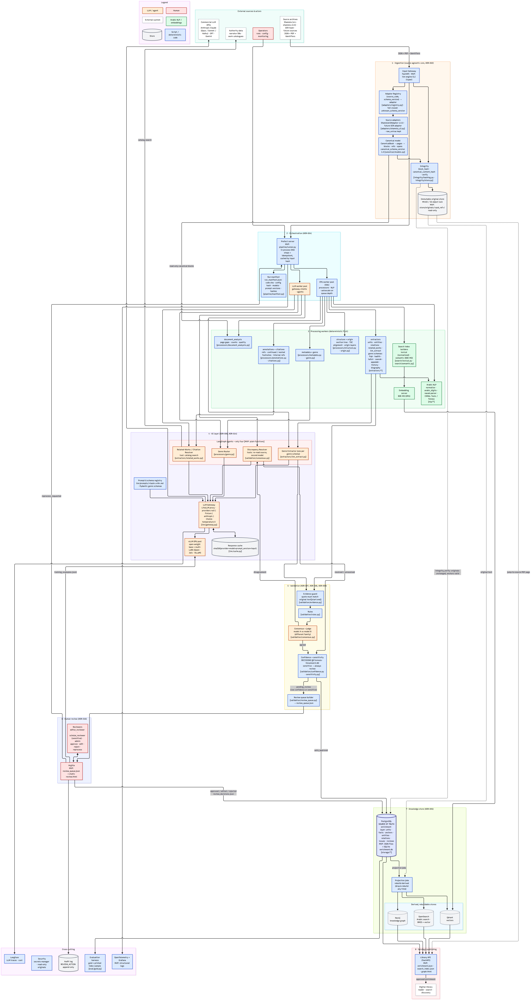
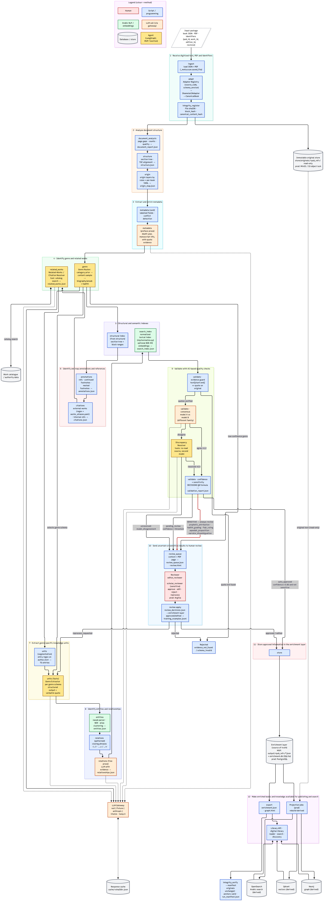

# ILM Engine: Technical Proposal

**Post-OCR knowledge enrichment for digitized Islamic books**

This proposal answers the technical assignment: architecture, data flow, technology and model strategy, knowledge extraction, model training, a working MVP on the sample book, and an implementation roadmap. Every number in §7 comes from a run of the MVP on the sample (`SUMMARY.md` of run `run_1bd3442413cc`), not from estimates.

---

## Executive summary

ILM Engine reads a digitized book (structured JSON plus page scans) and writes a separate **enrichment layer**: bibliographic metadata, a section index, footnote and citation links, knowledge units, people and their relationships, related works, a search index and a knowledge graph. Three properties hold for every record:

1. **The original is never modified.** Inputs are copied into a read-only store and re-hashed at the end of every run; a changed byte fails the run.
2. **Every fact is traceable.** Each record carries an anchor (`pub_ref`, page, block, character offsets, verbatim quote, block hash). The quote must equal the original text at those offsets, or the record is rejected.
3. **Author, editor and AI are kept apart.** Each record states whose words it is (`author_text`, `transmission_isnad`, `editor_text`, `editor_footnote`, `ai_generated`) and whether the fact is `stated` or `inferred`.

The MVP is a runnable Python pipeline (21 steps, 680 tests). On the sample book, *al-Ikhwa wa al-Akhawat* by al-Daraqutni, it finds all **75** biographical entries, links **300 of 300** footnote references, joins **16** footnotes continued across pages, finds the one nested footnote, and extracts **111** people and **173** relationships. It routes **136** uncertain or sensitive items to scholar review. Against the editor's printed index of narrators, the extracted entry subjects score **precision 1.0, recall 1.0** (75/75). The run takes about 4 seconds without any API key, and two runs produce byte-identical outputs.

The production design scales the same pipeline to the archive (≈10,000 books, ≈500 new books per month) with Prefect, PostgreSQL as source of truth, derived Qdrant/Neo4j/OpenSearch stores, Argilla for review, and a commercial-plus-open-weight model strategy that moves high-volume tasks to fine-tuned self-hosted models.

---

## Scope understanding

The archive already holds books as structured JSON produced by a Shamela adapter (`src-shamela`, schema 3.0). An in-house OCR team will deliver other books in other formats. The goal is to enrich books without changing them, so that scholars and readers can search, navigate and verify knowledge back to the exact page and line.

What the sample book tells us, and what the design has to handle:

- **It is genealogy (ansab), not prose.** Seventy-five numbered entries, grouped by family; siblings are often closed with a dual or plural phrase ("ابنا أبي هالة", "بنو عبد المطلب") instead of being named one by one.
- **Three voices in one book.** The editor's introduction (pp. 3–16), the manuscript title page and chain of transmission (pp. 17–19), the author's text (pp. 20–72), and 317 editor footnotes.
- **Rich but imperfect structure.** All 300 footnote references resolve, but 16 footnotes continue across pages, one footnote is nested inside another (marker "أ"), and the TOC page keys are Shamela keys, not printed page numbers (offsets 2, 3 and 4).
- **Hard linguistic cases.** Two different people named "هند" stand next to each other (#8 female, #9 male); "لأم ولد" means the mother was an umm walad, not that the siblings share a mother; entry #32 starts in the middle of a sentence.
- **Sensitive content.** Hadith gradings in the footnotes ("وإسناده ضعيف"), Prophetic speech, and narrator identity must never be published without a scholar.

**Out of scope for the MVP:** OCR, a public UI, and production infrastructure; these are designed (§1, §8) and backlogged as tickets.

---

## Architectural principles

| Principle | How it is enforced |
|---|---|
| Originals are immutable | Read-only content-addressed store; before/after hash checks; the pipeline has no write path to `data/` or `store/originals/` |
| Traceability by construction | Records cannot be created without an anchor; the evidence guard rejects quotes that are not in the cited block |
| Cheapest reliable method first | Deterministic rules → Arabic NLP → small model → large model → agent → human; a task moves right only when the method on its left cannot do it reliably |
| One canonical shape | Every source format goes through an adapter into one canonical book; unknown formats fail closed |
| Repeatable | Deterministic IDs, temperature-free cached LLM calls, versioned prompts, a run manifest with every hash and version |
| Humans approve what matters | Confidence scoring, two-model consensus, sensitive categories always reviewed |
| Configuration over code | Thresholds, patterns, aliases and per-book overrides live in YAML |

---

## 1. System architecture



*Source: `deliverables/diagrams/system-architecture.mmd` (rendered SVG and PNG alongside).*

**Layers, left to right:**

- **Ingestion.** An input gateway accepts the JSON, the PDF and identifiers. The **adapter registry** picks the adapter by `(source_code, schema_version)` and refuses anything it does not know. Adapters convert to the **canonical book** (pages, blocks, refs, spans, TOC, metadata) and keep every unmapped field in `raw_extras`.
- **Integrity.** Originals are copied once into a read-only store (MinIO/S3 with object lock in production); per-block SHA-256 hashes and a canonical content hash are recorded.
- **Processing (deterministic workers).** Document analysis, structure and TOC alignment, origin layers, metadata, annotations and citations.
- **AI layer.** An LLM gateway (provider-agnostic, cached) behind exactly four agents: Genre Router, Genre Extractor, Related-Works/Citation Resolver, Discrepancy Resolver. Everything else is a deterministic worker.
- **Validation.** Evidence guard, rule checks, consensus, confidence, sensitivity.
- **Human review.** Priority queue for scholars and editors (Argilla in production), with audit and training export.
- **Knowledge store.** PostgreSQL is the source of truth; Qdrant (vectors), Neo4j (graph) and OpenSearch (Arabic search) are derived projections that can be rebuilt at any time.
- **Serving.** A publishing and search API over approved records only.
- **Cross-cutting.** Security (role-based review, provider allow-list for private books), observability (OpenTelemetry, Langfuse for LLM traces), audit log.

**MVP vs production.** The MVP runs the same layers in one process: an in-process DAG runner instead of Prefect, JSON files plus SQLite instead of PostgreSQL, a JSON queue and static HTML page instead of Argilla, and files (`search_index.json`, `graph.html`, `graph.cypher`) instead of the derived stores. Step functions, data contracts and IDs are the same, so the move is a change of runners and stores, not of logic.

---

## 2. Data flow and automation



The assignment's twelve steps map to the pipeline's 21 steps (`src/ilm_engine/pipeline/README.md`). Colours in the diagram mark the method: script, NLP, LLM, agent, human.

| Assignment step | Pipeline steps | Method |
|---|---|---|
| 1. Receive text, PDF and identifiers | `ingest` → `adapt` → `integrity_register` | Script |
| 2. Analyse document structure | `document_analysis`, `structure`, `origin` | Script |
| 3. Extract and enrich metadata | `metadata` | Script + optional LLM check |
| 4. Identify genre and related works | `genre`, `related_works` | Script + agents (router, citation resolver) |
| 5. Structural and semantic indexes | `structure`, `search_index` | Script + NLP (+ optional embeddings) |
| 6. Map annotations and references | `annotations`, `citations` | Script |
| 7. Extract genre-specific knowledge units | `units` | Rules + LLM with evidence (genre extractor) |
| 8. Identify entities and relationships | `entities`, `relations` | Rules + NLP (nasab parser) + LLM |
| 9. Validate with AI-based quality checks | `validate` | Evidence guard, rules, consensus, confidence, sensitivity |
| 10. Send uncertain or sensitive results to review | `review_queue` | Human |
| 11. Store approved information | `store` | Script |
| 12. Publish and search | `export` | Script |
| Integrity and provenance | `integrity_verify`, `manifest` | Script |

**Automation properties.** Each step is a pure function of its inputs, the configuration sections it reads and the LLM responses. Its cache key covers exactly those, so a re-run without changes executes nothing, and changing one threshold re-runs only validation and the steps after it. A failure stops the run at that step; the next run resumes from there.

**Agents and tools.** The four agents and their tools (catalog search, block reader, schema validator, second model) are shown in `diagrams/agent-workflow.png`. Agents only decide what to do next; every claim they produce still goes through the evidence guard and validation. The adapter flow (`diagrams/adapter-flow.png`) shows how new formats plug in.

---

## 3. Technology recommendations

| Concern | MVP (built) | Production (recommended) | Why |
|---|---|---|---|
| Language, packaging | Python 3.12, uv | same | Arabic NLP and ML ecosystem; reproducible lockfile |
| Data contracts | Pydantic v2 (frozen models, exported JSON Schemas) | same | One contract for code, storage, LLM structured output and API |
| Orchestration | In-process DAG runner with per-step cache | **Prefect** (steps map 1:1 to tasks) | Retries, concurrency limits for LLM calls, work pools; no Celery/Redis needed |
| Original storage | Read-only local store | **MinIO/S3 with object lock** | Immutability guaranteed by the store, not by convention |
| Source of truth | SQLite (`enrichment.db`) | **PostgreSQL 16** | Relational integrity, JSONB for payloads, row-level security for review |
| Search | Normalized BM25 index (`search_index.json`) | **OpenSearch** with an Arabic analyzer, hybrid with vectors | Arabic tokenization, highlighting, scale |
| Vectors | Optional BGE-M3 (local) | **Qdrant** | Semantic search and cross-book similarity |
| Graph | `graph.html` + `graph.cypher` | **Neo4j** | Genealogies, isnad chains, book families |
| LLM access | Gateway with null / fixture / Anthropic / LiteLLM providers | **LiteLLM proxy** + direct Anthropic SDK; **vLLM** for self-hosted models | Swap models by configuration; cache; budget control |
| Agents | Plain functions behind the agent interface | **LangGraph** | Explicit state machines for the four agents |
| Arabic NLP | Own normalizer with offset map, nasab parser, number words; optional CAMeL Tools | CAMeL Tools, Farasa | Normalization must map back to original offsets |
| Human review | `review_queue.json` + static `review.html` | **Argilla** | Multi-reviewer projects, roles, training exports |
| API | CLI (`run`, `verify`, `search`, `eval`, `review`, `rebuild-derived`) | **FastAPI** publishing and search API | Typed, documented, easy to secure |
| Observability | `run_manifest.json`, JSON logs | **OpenTelemetry + Grafana**, **Langfuse** for LLM traces and cost | Per-book cost and quality visibility |

---

## 4. Arabic NLP and AI model strategy

**Principle: cheapest reliable method first.** In the sample, rules and Arabic NLP produce all 75 units, all annotation links, the citations and 78 stated relationships without any model. Models are reserved for what rules cannot read reliably: facts in free prose, genre-specific payloads (fiqh rulings, hadith gradings), disambiguation and judging disagreements.

**Arabic NLP (built).**

- **Normalization with an offset map.** Diacritics, tatweel, alef and ya variants, ta marbuta, Arabic-Indic digits and the honorific "صلى الله عليه وسلم"/ﷺ are normalized in a *derived* copy only; every normalized character keeps the original span it came from, so a match on normalized text maps back to exact original offsets. "الدارقطني" and "الدَّارقطني" return identical search results.
- **Nasab parser.** Reads ism, kunya, laqab, nisba and the chain of ancestors, skipping footnote markers inside names ("هند بنت عتيق بن عابد (١) بن عبد اللَّه…").
- **Number words.** "سنةٍ خمسٍ وثمانين وثلاث مئة" → 385 (the author's death year, anchored in block b000049).
- **Optional morphology** through CAMeL Tools (root and lemma), off by default.

**Model matrix.**

| Role | Commercial | Open-weight | Used for |
|---|---|---|---|
| Default extractor | Claude Sonnet 5.5 (`claude-sonnet-5-5`) | Qwen instruct (mid size) | Facts, metadata in prose, relations in prose |
| Hard reasoning, escalation, judge | Claude Opus 5.5 (`claude-opus-5-5`) | Qwen instruct (large) | Fiqh rulings, khilaf, disagreements |
| Bulk, cheap | Claude Haiku 5.5 (`claude-haiku-5-5`) | Small fine-tuned Qwen (Phase 3) | Genre tagging, sensitivity tagging |
| Independent verifier | A different family (GPT or Gemini class) via LiteLLM | Jais, ALLaM (Arabic-centric) | Two-model consensus |
| Encoders | — | CAMeLBERT, AraBERT (fine-tuned) | NER, block classification |
| Embeddings, rerank | optional | BGE-M3, BGE reranker | Semantic search, cross-book similarity |

Only Anthropic model versions are fixed here; the other checkpoints are chosen on our evaluation set and pinned in configuration. The configuration rejects a verifier from the same family as the extractor, because consensus is only meaningful across families.

**How LLM output is made safe.**

1. **Mandatory evidence.** Every fact must quote its source verbatim; the model only sees the blocks it may cite. In tests, a hallucinated quote ("ولدت في مكة") is rejected with `evidence_not_found` and never stored.
2. **Structured output.** Responses are validated against the genre's Pydantic schema, with one repair attempt.
3. **Two-model consensus.** Agreement raises confidence (×1.2); a disagreement (born 1200 vs 1205 AH) is never settled silently: a judge model must choose with evidence, or the item goes to review with both values.
4. **Confidence.** `clamp01(base × evidence × schema × agreement × penalties)`, with every factor in configuration and the breakdown stored on the item.
5. **Repeatability.** Current Claude models do not accept sampling parameters, so repeatability comes from the response cache keyed by provider, model, task, prompt version and canonical input; prompts are versioned files whose hashes are locked.
6. **Privacy.** With the default `null` provider nothing leaves the machine; a per-source allow-list can force self-hosted models.

---

## 5. Knowledge extraction approach

### Genre-specific extraction

The **Genre Router** combines the source category (a strong prior: `الأنساب` → biography/ansab) with content signals (takhrij formulas in footnotes → secondary hadith). Each genre is a **plugin** with its own payload schema, sensitive fields, candidate detector and prompt:

| Genre | Unit | Key payload fields | Always reviewed |
|---|---|---|---|
| Biography / ansab (built) | biographical entry | person, nasab, kunya, laqab, birth, death, relatives, companion status | narrator disambiguation |
| Hadith (candidates built) | hadith / takhrij | matn, isnad, takhrij references, grading | grading, Prophetic attribution |
| Fiqh | masala | question, ruling, evidence, madhhab, khilaf | ruling |
| Tafsir | tafsir unit | ayah reference, explanation, opinions | — |
| Seerah, history | event | event, date, place, persons | — |
| Aqeedah | proposition | concept, proposition, evidence | proposition |

All seven schemas are implemented and exported as JSON Schema; the sample exercises biography fully and hadith takhrij in the footnotes (block b000228 parses to collector references and the grading "ضعيف", flagged sensitive).

### Entity recognition, linking and relationships

- **Entities** come from entry subjects (nasab parser), from fixed authorities (the Prophet ﷺ, the author, the editor) and from parents and mothers named in the text. Mentions are merged only on strong evidence (same ism and two shared ancestors, or same kunya and nisba), never on the ism alone. The author's three full-name forms and his nisba variants merge into one entity with eight aliases, while Hind #8 and Hind #9 stay separate.
- **Sibling groups** come from closing phrases: a dual ("ابنا …") closes the last two entries, a plural ("بنو …") every entry since the previous closure. An elliptic subject ("٩ - وهند.") inherits the lineage of the named parent and becomes "هند بن أبي هالة", male.
- **Relation kinds.** Same father and same stated mother → `full`; "لأم ولد" → `mother_status: umm_walad`, never `maternal`; mothers named with "أمه / أمهما / أمهم" give `mother_is` relations with the right scope.
- **Inferred relations.** "Fatimah is a child of the Prophet ﷺ" is never written in her entry; it follows from the section heading. Such relations are marked `inferred` and `ai_generated`, cite both the heading and the entry, and always go to review.

### Source-location mapping

Every record carries one or more anchors:

```json
{"pub_ref": "pub_01M0CJECV4ZHFTP02BJQ6D3STJ@r6", "page": 25, "scan_page": 25,
 "block_id": "b000135", "start": 60, "end": 65, "quote": "أسلمت",
 "block_hash": "sha256:56770406…"}
```

Offsets are character positions in the original, un-normalized text. `scan_page` links to the PDF page for reviewers. The final pipeline step re-checks every anchor in the output (1,971 on the sample) against the original blocks; `ilm-engine verify` does the same for any finished output and names a broken anchor by its JSON path. When a new revision arrives, blocks are compared by hash: anchors on changed blocks become `stale`, on removed blocks `orphaned`, and only those units are re-processed.

---

## 6. Model training approach

**When.** Not before enough reviewed data exists: about 2–5k reviewed units per task. Until then, prompting with few-shot examples taken from reviewed units is cheaper and good enough.

**Datasets.**

1. **Weak supervision from structure.** Shamela structure gives labels for free: headings → sections, refs → annotation links, entry numbers → unit boundaries, entry footnotes → person mentions.
2. **Distillation with review.** A large model extracts; only human-approved or human-edited outputs become training data, rejected ones become negatives. The MVP already writes `training_examples.jsonl` for every approved or edited review item.
3. **Active learning.** Low-confidence items are reviewed first, so the hardest cases enter the training data first.
4. **Gold sets for testing only.** Printed indexes (the sample's narrator index is transcribed in `eval/gold_index_sample.json`) and expert-annotated books; never used for training. Splits are by book, stratified by genre and century.

**Method.** LoRA / QLoRA (PEFT) on an open-weight model chosen on our Arabic dev set (Qwen instruct 7–32B, Jais or ALLaM): 4-bit base, rank 16–64, 2–3 epochs, the same JSON schema as the prompts so swapping the model changes nothing downstream. Encoders (CAMeLBERT) are fully fine-tuned for NER and block classification. Serving uses vLLM with multi-LoRA: one base model, one adapter per genre or task, selected by the router.

**Infrastructure.** 1–2 × A100/H100 80 GB for training runs, 1 GPU per serving replica, experiment tracking with MLflow or Weights & Biases. **Metrics:** entity F1, relation F1, fact precision/recall, evidence accuracy (quote found at the anchor), schema validity rate, and reviewer acceptance rate.

---

## 7. MVP on the sample book

The MVP is the repository itself: `uv sync`, then `uv run ilm-engine run --input data`. It needs no API key (LLM-dependent work is flagged `needs_llm`); `--llm anthropic` enables model extraction. All figures below are from run `run_1bd3442413cc` (`output/<pub_ref>/SUMMARY.md`).

| Capability (assignment §5.7) | Output | Result on the sample |
|---|---|---|
| Metadata extraction | `metadata.json` | Title, author (death 385 AH confirmed from the text, b000049), editor, publisher, edition 1, 1413 AH / 1993; title variant and the author-name variant "بن مهدي" (p. 17) recorded, not resolved |
| Structural indexing | `structure.json` | 18 sections (17 TOC entries + root), TOC aligned through Shamela page keys (offsets 2–4), page index |
| Knowledge-unit extraction | `knowledge_units.json` | 75 units, numbered 1–75 without gaps, including #32 mid-sentence; 36 rule-based facts with exact anchors |
| Entity and relationship identification | `entities.json`, `relationships.json` | 111 people; 173 relationships: 46 stated siblings, 32 stated parents, 31 mothers, 64 inferred (always reviewed) |
| Annotations and citations | `annotations.json`, `citations.json`, `related_works.json` | 300/300 refs resolved, 16 continuations joined, 1 nested footnote; 674 citations of 99 works; 2 same-topic works from the editor's preface |
| Source-location mapping | anchors in every file | Every anchor re-verified at the end of the run; 0 failures |
| Structured JSON output | `enrichment.json`, `enrichment.db` and 16 more output files | `enrichment.json` validates against the exported JSON Schema |
| Search and graph | `search_index.json`, `graph.html`, `graph.cypher` | Normalized BM25 search; graph of people and works; rebuildable byte-for-byte from the database |
| Human review | `review_queue.json`, `review.html` | 136 items: 15 sensitive (scholar), 44 discrepancies, 64 low confidence, 12 structural, 1 needs-LLM |
| Evaluation | `eval_report.json` | Entry subjects vs the printed narrator index: precision 1.0, recall 1.0, F1 1.0 (75/75); lineage agreement 41/41 |

**Repeatability and integrity.** Two runs give byte-identical outputs (only the manifest's timestamps differ); the data folder's hashes are unchanged after a run; `ilm-engine verify` checks inputs, outputs and anchors. The source's own `content_sha256` could not be reproduced (it is kept as unverified and raised as an open question); integrity relies on our own hashes.

**Known limitations of the MVP.** LLM extraction, consensus and the judge are implemented and tested with scripted model responses, but were not run against a live model for the figures above; only rule-based facts are counted. Parents named in closing phrases are created as new people and not yet linked to the same person's own entry (e.g. "عمر" and entry #54). Page- and name-based backward references ("تقدمت ترجمته (ص: ٢٨)") are kept but left unresolved for review. Of the seven genre plugins, biography is fully implemented, hadith has takhrij and grading detection, and the other five have schemas but no prompts or extractors yet.

---

## 8. Implementation roadmap

| Phase | Duration | Goal | Exit criteria |
|---|---|---|---|
| **0. MVP / PoC** | done + 2–4 weeks hardening | Prove the pipeline on real data; lock schemas | 10–20 books from 3+ genres processed; client sign-off on schemas |
| **1. Core platform** | ~3 months | Production backbone: PostgreSQL, MinIO, Prefect, OCR-team adapter, Argilla, FastAPI, CI/CD, observability | 100 books ingested, reviewed and published end to end |
| **2. Extraction at depth** | ~4 months | All seven genres, LangGraph agents, consensus, Neo4j, OpenSearch + Qdrant | Per-genre F1 ≥ 0.85 on gold sets; sensitive routing 100% |
| **3. Scale and model adaptation** | ~3 months | QLoRA adapters on vLLM, small→large routing, batch, incremental reprocessing | 500 books/day; fine-tuned model ≥ commercial baseline on 2+ tasks |
| **4. Cross-book discovery** | ongoing | Book families, matn↔sharh alignment, authority linking, discovery API/UI | Targets on reviewed samples |

**Major technical challenges.** Classical Arabic ambiguity (duals covering two entries, "لأم ولد"); same-name people; heterogeneous sources and schema drift; revisions changing text under anchors; annotation complexity; LLM hallucination and cost at 3M pages; scarce scholar reviewers; OCR noise in future sources; confidence calibration. Each has a mechanism in the design (see `docs/08-roadmap.md` §2).

**Infrastructure.** Phase 1: a few CPU workers, managed PostgreSQL (≈50–100 GB), object storage ≈0.5–1 TB (scans dominate), commercial LLM APIs. Phase 2: autoscaled workers, OpenSearch (3 nodes), Qdrant (10–30M vectors), Neo4j. Phase 3: 1–2 GPUs for QLoRA training, 1–2 for vLLM serving.

**Team.** Tech lead, 2 backend/data engineers, 1–2 Arabic NLP/ML engineers, 0.5–1 MLOps, 2–4 part-time scholar reviewers, 0.5 product manager. Implementation is organised as 82 small tickets with acceptance criteria (72 for the MVP, all done; 10 production backlog), which also lets coding agents execute them.

**Indicative costs** (order of magnitude, depending on scale and API policy): LLM extraction of the back catalogue US$5k–25k one-off and US$300–1.5k per month for new books; managed databases and storage US$1k–4k per month; GPU serving US$1.5k–5k per month from Phase 3. Reviewer time is the largest ongoing cost, which is why the queue is prioritised.

---

## Technical considerations compliance

| Consideration (assignment §6) | Mechanism | Evidence in the MVP |
|---|---|---|
| Original content remains untouched | Read-only store, hashes before/after, no write path to inputs | `integrity_verify` step; `test_invariants.py`, `test_e2e.py` |
| Enrichment stored separately and linked | Separate output files and database; anchors with block hash | `enrichment.json`, `enrichment.db` (block table stores hashes, never text) |
| Every knowledge unit traceable | Mandatory anchors, evidence guard | All anchors re-verified each run; `verify` names a broken anchor |
| Author statements distinguished from AI interpretation | `origin` (5 layers) and `assertion` (stated / inferred) | 64 inferred relations, all `ai_generated` and reviewed |
| Modular, repeatable, scalable | Adapters, genre plugins, deterministic IDs, per-step cache, manifest | Second adapter added without pipeline changes; byte-identical reruns |
| Confidence and human approval | Confidence formula, consensus, sensitive rules, review queue with audit | 136 review items; scholar role enforced; training export |

---

## Risks

| Risk | Mitigation |
|---|---|
| Other sources differ from the sample | Adapter registry, golden contract tests, fail-closed; an example OCR-team adapter is already in place |
| Hallucinated religious content gets published | Evidence guard, consensus, sensitive categories always reviewed, publish only approved or confidently auto-approved non-sensitive items |
| Reviewer bottleneck | Priority queue (sensitive and disagreements first), confidence calibration to raise the auto-approve rate, sample audits |
| External LLM APIs not allowed for some books | Provider allow-list; self-hosted vLLM path |
| Cost overrun at scale | Rules first, cache, batch, small-model routing, QLoRA migration, budget alerts |
| Confidence miscalibrated | Calibrate factors per genre on reviewed samples; thresholds in configuration |

---

## Assumptions and open questions

| | Assumption (used until answered) | Question to the client |
|---|---|---|
| Q-HASH | The source `content_sha256` is unverified; our hashes prove integrity | Which method produces `content_sha256`? |
| Q3 | Block IDs are stable within a revision; across revisions anchors are re-validated by hash | Are block IDs stable across revisions? |
| Q5 | Each new source format gets its own adapter | Can we get an early sample of the OCR team's format? |
| Q6 | Commercial LLM APIs are allowed for the demo; the MVP also runs without any key | Are there books whose text must not leave your infrastructure? |
| Q7 | No authority database exists, so we propose our own entity model | Is there an existing narrator/scholar authority list? |
| Q8 | ≈10,000 books, ≈3M pages, ≈500 new books per month | What are the real volumes? |
| Q9 | 2–4 part-time scholar reviewers | How much reviewer time is available? |

---

## Appendix: data findings from the sample

Facts re-computed from the sample JSON and scan while building the MVP:

- 68 pages held (printed 3–72), 72 claimed; printed pages 1, 2, 4 and 18 are missing and are non-content pages (cover, publisher page, basmala, blank). The source's quality check passed although 5.6% short exceeds its 5% tolerance.
- 594 blocks: 260 text, 317 footnote, 15 heading, 2 toc_heading. Span classes: c2 230 (footnote markers), c5 64, c1 8 (Prophetic speech, inferred), c4 2.
- 300 refs, all resolvable, none from footnotes. 16 continued footnotes; each continues the previous page's footnote ending with "=", which is not always the page's last footnote (on p. 33 the nested note b000215 is printed after it).
- The two TOC entries without a heading block (pp. 5 and 19) were placed as `toc_heading` by the source.
- 75 entries; #32 starts mid-sentence in b000294 ("وأختهم: ٣٢ - أروى"); 74 entries have an entry-level footnote.
- The editor's numbered lists on pages 6–12 match the same "N - " pattern as entries; the origin layer keeps them out.
- Citations: "الإصابة" is quoted 145 times in the footnotes (earlier specification drafts said 144), أسد الغابة 67, السير 59, الطبقات الكبرى 45, الاستيعاب 31, التهذيب 32 (ambiguous between two works, left for review).
- The printed narrator index is on PDF pages 76–79 and lists entry numbers, not pages; all 75 rows were transcribed and confirmed against the text.
- Some Arabic words in the specification were typed with diacritics in a different code-point order than the source ("اللَّه"); they look identical but do not hash the same. Tests use the source text exactly, which is the behaviour the integrity design requires.
