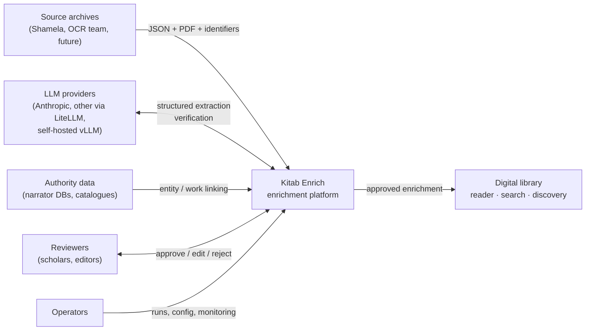
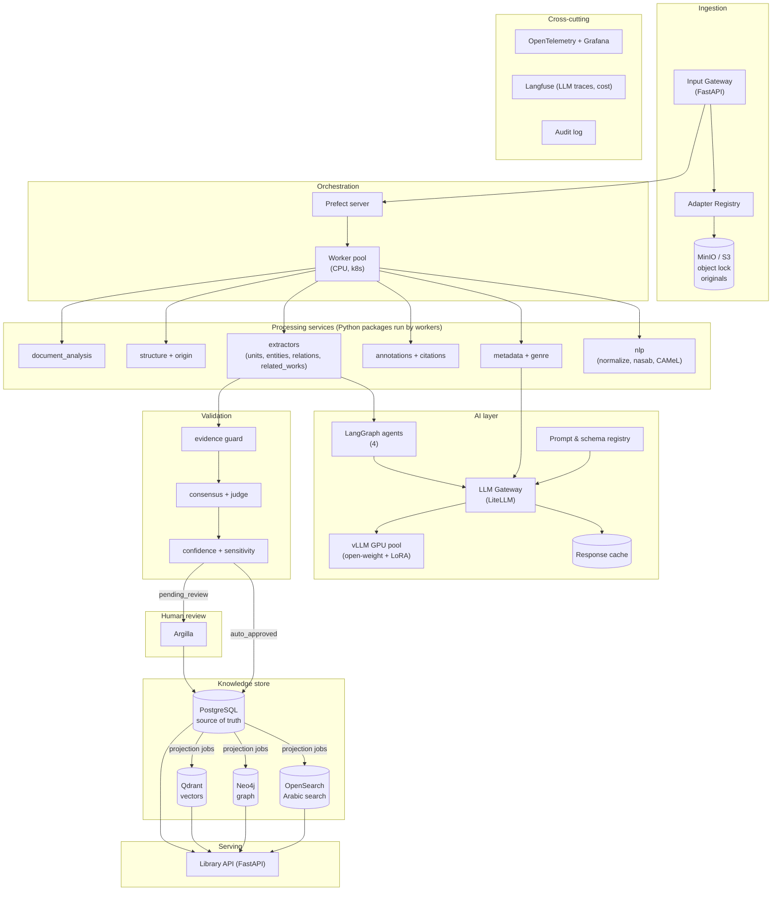
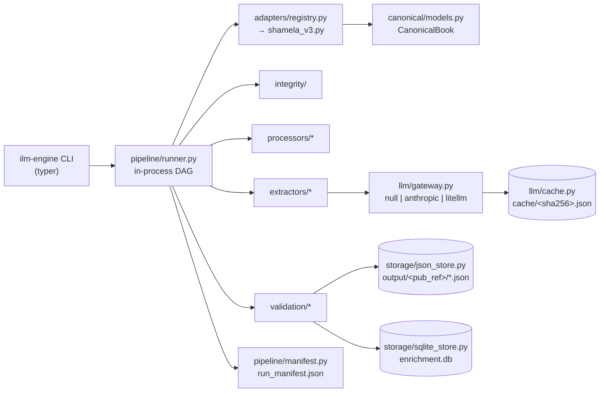
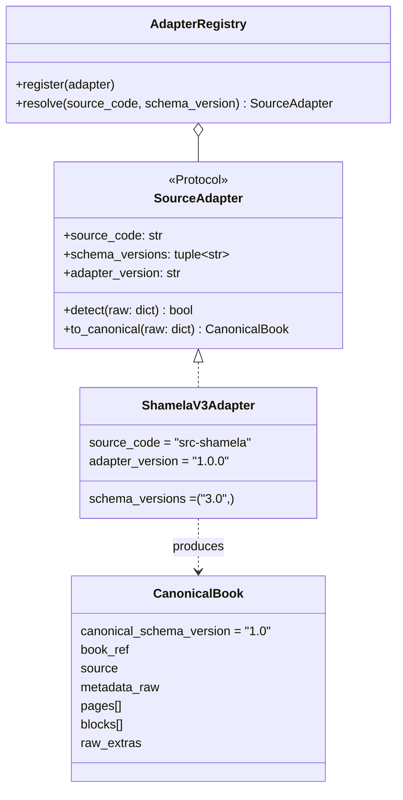
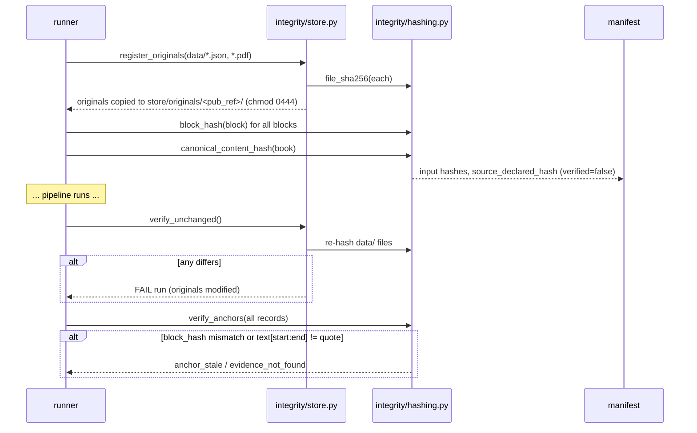
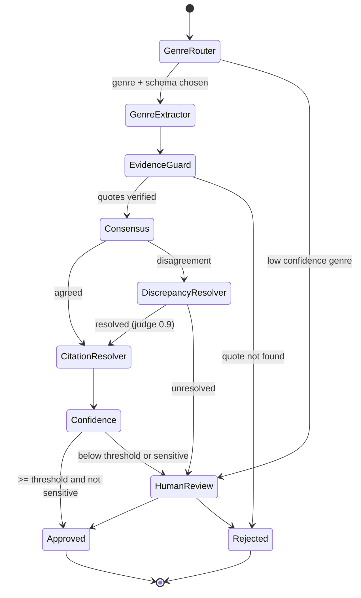
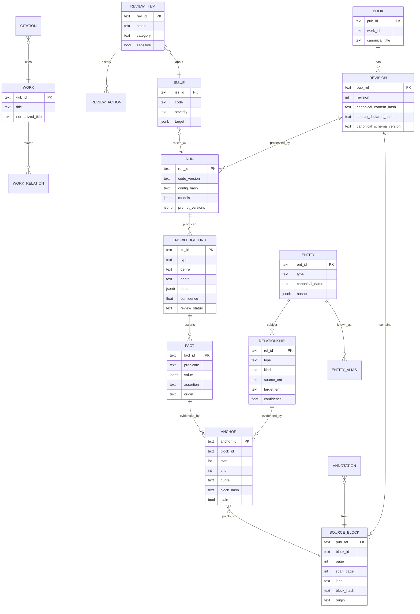
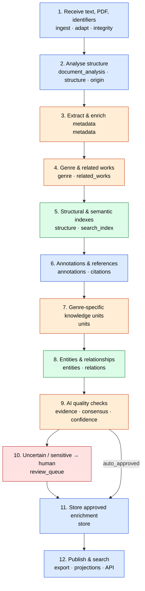
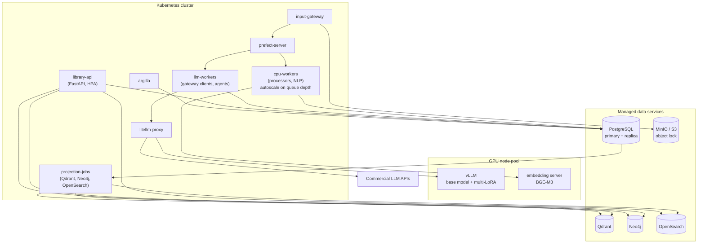

# 02 — Architecture

Status: Accepted (v1.0). Names, paths, fields and thresholds follow [DECISIONS.md](DECISIONS.md). Decisions with alternatives are recorded in [adr/](adr/).

---

## 1. Architectural principles

| # | Principle | Consequence |
|---|---|---|
| P1 | **Original content is immutable** | `data/` and the original store are read-only; enrichment never copies-and-edits text; integrity is checked by hashes every run |
| P2 | **Enrichment is a separate, linked layer** | Every record references the source by an **anchor** (`pub_ref, page, block_id, start, end, quote, block_hash`) |
| P3 | **Traceability is mandatory** | A fact without a verifiable anchor is rejected (`evidence_not_found`) |
| P4 | **Provenance of voice** | Every unit/fact carries `origin` (`author_text`, `transmission_isnad`, `editor_text`, `editor_footnote`, `ai_generated`) and `assertion` (`stated` / `inferred`) |
| P5 | **Source-agnostic core** | Only adapters know source formats; everything downstream consumes `CanonicalBook` |
| P6 | **Fail closed** | Unknown schema versions, invalid schemas or hash mismatches stop the step and raise an issue; nothing is guessed |
| P7 | **Deterministic first, AI second** | Use code where the data already has structure; NLP for linguistics; LLM only where meaning is required; agents only where multi-step decisions/tools are required |
| P8 | **Repeatable** | Deterministic IDs, pinned model + prompt versions, temperature 0, response cache, run manifest; same input → same output hashes |
| P9 | **Human authority on sensitive content** | Sensitive categories always go to review regardless of confidence |
| P10 | **Modular & replaceable** | Each layer is a step with a typed input/output contract; any layer, model or store can be swapped |

---

## 2. Context diagram



---

## 3. Container / component view

### 3.1 Production



### 3.2 MVP (single process, no infrastructure)



The MVP and production share the same package; production swaps the runner for Prefect and the stores for Postgres + projections (ADR-004, ADR-006).

---

## 4. Layer-by-layer specification

All steps are pure functions of their inputs + config + model responses, registered in `pipeline/steps.py`:

```python
class Step(Protocol):
    name: str
    version: str                     # bump when logic changes
    depends_on: tuple[str, ...]
    def run(self, ctx: RunContext) -> StepResult: ...

@dataclass
class StepResult:
    outputs: dict[str, Any]          # keyed by output file name
    issues: list[Issue]
```

`RunContext` provides: `book: CanonicalBook`, `config`, `llm: LLMGateway`, `results: dict[str, StepResult]` of dependencies, `ids: IdFactory`, `logger`.

| # | Layer / module | Responsibility | Inputs | Outputs | Method | Failure modes → handling |
|---|---|---|---|---|---|---|
| L1 | `adapters/*` | Parse source JSON into `CanonicalBook` | raw JSON | `CanonicalBook` | 🟦 | unknown `(source_code, schema_version)` → `unknown_schema_version`, stop; missing required field → `schema_invalid`, stop |
| L2 | `integrity/*` | Copy originals read-only, compute `block_hash`, `canonical_content_hash`; record `source_declared_hash` | raw files, `CanonicalBook` | hashes → `run_manifest.json` | 🟦 | hash mismatch with previous run of same revision → stop; source hash not reproducible → `source_hash_unverified` (warn) |
| L3 | `processors/document_analysis.py` | Page gaps, counts, quality reconciliation, empty/duplicate blocks | `CanonicalBook`, source quality record | `document_report.json` | 🟦 | `missing_page`, `page_count_mismatch` (classified: non-content vs content) |
| L4 | `processors/structure.py` | Section tree from `heading`/`toc_heading`; align TOC (`source_page` = Shamela key) | blocks, TOC | `structure.json` | 🟦 (+🟧 for unmarked sources) | `toc_without_block`, `heading_without_toc`, `toc_page_offset` |
| L5 | `processors/origin.py` | Assign `origin` per block by section rules + per-book override YAML | structure, config | `origin_map.json` | 🟦 | block with no rule → `editor_text` default + `needs_llm` |
| L6 | `processors/metadata.py` | Bibliographic record from card + preface evidence; conflicts | metadata card, preface blocks | `metadata.json` | 🟦 + 🟧 | `metadata_conflict`, `title_variant` |
| L7 | `processors/genre.py` | Primary/secondary genre; selects extractor schema | category, sampled content | `metadata.json#genre` | 🟦 + 🟧 (Genre Router) | low confidence → review |
| L8 | `processors/annotations.py` | Resolve `refs`; join `continues` footnotes; nested footnotes by marker | blocks | `annotations.json` | 🟦 | `broken_ref`, `unlinked_footnote`, `nested_footnote`, `continued_footnote_joined` |
| L9 | `processors/citations.py` | External works cited (title + vol/page) and internal references ("ترجمة رقم (٣٣)", "كما سيأتي") | footnotes, text | `citations.json` | 🟦 + 🟩 | `unresolved_internal_ref` |
| L10 | `extractors/units.py` (+ `genres/*`) | Knowledge units per genre schema; for this book 75 biographical entries | `author_text` blocks, annotations | `knowledge_units.json` | 🟦 + 🟧 (Genre Extractor) | `numbering_gap`, `numbering_duplicate`, `entry_without_footnote` |
| L11 | `extractors/entities.py`, `nlp/nasab.py` | Person entities, nasab chains, aliases, linking | units, footnotes | `entities.json` | 🟩 + 🟧 | `ambiguous_entity` |
| L12 | `extractors/relations.py` | Sibling groups (closing phrases "ابنا…", "بنو…"), parent/child, maternal/paternal, umm walad | units, entities | `relationships.json` | 🟦 + 🟧 | grammar mismatch penalty; `needs_llm` without provider |
| L13 | `extractors/related_works.py` | Book family / related works (`cites`, `same_topic_as`, `sharh_of`…) | citations, preface | `related_works.json` | 🟦 + 🟧 (Citation Resolver) | unresolved title → review |
| L14 | `search/lexical.py`, `search/semantic.py` | Normalized lexical index; optional embeddings | blocks, units | `search_index.json` | 🟩 | embeddings unavailable → skipped, recorded in manifest |
| L15 | `validation/*` | Evidence guard, rules, consensus, confidence, sensitivity | all extracted records | `validation_report.json` | 🟦 + 🟧 (Discrepancy Resolver) | `evidence_not_found` → reject; `model_disagreement` → review |
| L16 | `validation/review_queue.py` | Build review items with context + PDF page | validated records | `review_queue.json` | 🟦 → 🟥 | — |
| L17 | `storage/*` | Persist enrichment; consolidated export | everything | `enrichment.json`, `enrichment.db` | 🟦 | write failure → run marked failed, no partial publish |

---

## 5. Adapter subsystem



- **Resolution key:** `(source_code, schema_version)`, read from `pub.source_code` and `revision.content.schema_version` (Shamela v3). No match → `unknown_schema_version` and stop (fail-closed).
- **Field mapping (Shamela v3 → canonical):** `b → id`, `kind → kind`, `text → text`, `marker`, `continues`, `spans`, `refs[{start,end,to}]`; page `n → page`, `scan_page`, `source_ref.key → source_key`, `source_ref.url → url`, `volume`; `order` = global position.
- **`raw_extras`:** any source field the adapter does not map is preserved verbatim under `raw_extras` (book, page or block level). Nothing is dropped silently.
- **Golden tests:** `tests/golden/<adapter>/<case>.input.json` → `<case>.canonical.json`. Every adapter must pass its golden cases; changes to the canonical output require updating the golden file in the same PR.
- **Versioning:** `canonical_schema_version` (`1.0`) changes only via ADR. Adapters have their own semver. Both are written into `run_manifest.json`.
- **Adding a source:** new file in `adapters/`, one `registry.register(...)` line, golden cases. No downstream change.

---

## 6. Integrity subsystem



- `block_hash = "sha256:" + sha256(text.encode("utf-8"))`, exact text, no normalization.
- **Revision change (r6 → r7):** compare block hashes per `block_id`. Unchanged → records carried over (re-anchored to new `pub_ref`); changed/removed → `anchor_stale`, record re-processed and sent to review; new blocks → processed.
- Pipeline code has no write path to `data/` or `store/originals/` (enforced by a test that hashes before/after).

---

## 7. LLM gateway

```python
class LLMGateway(Protocol):
    def extract(self, task: str, prompt_version: str, input: dict,
                schema: type[BaseModel], model: str | None = None) -> LLMResult: ...

@dataclass
class LLMResult:
    data: BaseModel | None      # validated against schema
    model: str                  # e.g. "claude-sonnet-5-5"
    prompt_version: str         # e.g. "relations.v1"
    cached: bool
    repaired: bool              # needed one schema-repair retry
    raw: str
```

- Providers: `null` (default; returns `None` → caller emits `needs_llm`), `anthropic`, `litellm` (any second provider / self-hosted vLLM).
- Prompts are versioned files `llm/prompts/<task>.v<N>.md`; the version is part of the cache key and the manifest.
- Determinism: temperature 0; cache key = `sha256(provider + model + prompt_version + canonical_json(input))`; cache stored under `cache/`.
- Every LLM output must include verbatim `quote` evidence; the evidence guard computes offsets and rejects non-matching quotes.
- Routing: Haiku-class for cheap classification, Sonnet-class for extraction, Opus-class or a different family as judge (see `06-ai-strategy.md`).

---

## 8. Agent workflow (the only four agents)



| Agent | Decides | Tools |
|---|---|---|
| **Genre Router** | which genre schema(s) and extractor to run | metadata reader, block sampler |
| **Genre Extractor** | knowledge units per genre schema | block reader, footnote reader, schema validator |
| **Related-Works / Citation Resolver** | which catalogued work a citation or mention refers to | catalog search, normalized title matcher |
| **Discrepancy Resolver** | how to settle model disagreement or metadata conflicts | re-read source, call second model, open issue |

In the MVP these are plain functions behind the same interface; production implements them as LangGraph graphs (ADR-005). Everything else is a deterministic worker.

---

## 9. Storage design

### 9.1 Production (PostgreSQL = source of truth)



Original text is **not** stored in Postgres (it lives in the object store); `SOURCE_BLOCK` holds identity, position and hash only.

**Derived, rebuildable stores** (projection jobs from Postgres; can be dropped and rebuilt any time):

| Store | Content | Rebuilt from |
|---|---|---|
| Qdrant | embeddings of blocks and units (BGE-M3) | `SOURCE_BLOCK` + original text, `KNOWLEDGE_UNIT` |
| Neo4j | entities, works, relationships, citations | `ENTITY`, `RELATIONSHIP`, `WORK`, `CITATION` |
| OpenSearch | original + normalized text, Arabic analyzer, hybrid BM25 + vector | object store text + Postgres metadata |

### 9.2 MVP (SQLite `enrichment.db`)

Tables mirror the above with `TEXT` JSON columns: `books, revisions, source_blocks, runs, knowledge_units, facts, anchors, entities, entity_aliases, relationships, annotations, citations, works, work_relations, issues, review_items`. The JSON files in `output/<pub_ref>/` are the primary MVP output; SQLite is written from the same objects (`storage/sqlite_store.py`).

---

## 10. Data flow: assignment §4 (12 steps) → pipeline steps



| Assignment step | `pipeline/steps.py` step names | Output file(s) |
|---|---|---|
| 1 Receive | `ingest`, `adapt`, `integrity_register` | `run_manifest.json` |
| 2 Structure | `document_analysis`, `structure`, `origin` | `document_report.json`, `structure.json`, `origin_map.json` |
| 3 Metadata | `metadata` | `metadata.json` |
| 4 Genre + related works | `genre`, `related_works` | `metadata.json#genre`, `related_works.json` |
| 5 Indexes | `structure` (structural), `search_index` (semantic/lexical) | `structure.json`, `search_index.json` |
| 6 Annotations + references | `annotations`, `citations` | `annotations.json`, `citations.json` |
| 7 Knowledge units | `units` | `knowledge_units.json` |
| 8 Entities + relationships | `entities`, `relations` | `entities.json`, `relationships.json` |
| 9 AI quality checks | `validate` | `validation_report.json` |
| 10 Human review | `review_queue` | `review_queue.json` |
| 11 Store | `store` | `enrichment.db` |
| 12 Publish + search | `export` (MVP), projection jobs + API (production) | `enrichment.json`, `graph.html` |

Final step always: `integrity_verify` (originals unchanged, anchors valid) and `manifest`.

---

## 11. Deployment view (production)



---

## 12. Scalability & performance

| Concern | Approach |
|---|---|
| Throughput | Book-level parallelism across workers; block-batch parallelism inside LLM steps; queue-depth autoscaling |
| LLM cost | Deterministic steps first (most of this book needs no LLM); route by difficulty (small → large model); batch APIs for bulk runs; response cache; fine-tuned open-weight models for high-volume tasks |
| Re-processing | Incremental: only steps whose `version`, config or input hash changed re-run; on new revision only changed blocks re-process |
| Storage growth | Postgres partitioned by `pub_ref` / genre; derived stores rebuilt asynchronously |
| Latency (serving) | Reads from OpenSearch/Qdrant/Neo4j projections; Postgres for detail |
| Back-pressure | Prefect concurrency limits per provider (rate limits), per GPU pool |

---

## 13. Extensibility points

| To add | Change only |
|---|---|
| New source / JSON format | new adapter + registry line + golden tests |
| New genre | `extractors/genres/<genre>.py` schema + prompt file + Genre Router label |
| New model / provider | gateway provider config; prompts unchanged; eval run before switching |
| New language | normalizer profile in `nlp/`, analyzer in OpenSearch, prompts per language |
| New relation / work-relation type | DECISIONS §11 + contract + ADR |
| New issue code | DECISIONS §9 first |

---

## 14. Security & privacy

- Originals in object storage with object lock; workers have read-only credentials to originals and write-only to enrichment tables.
- Secrets (API keys) via environment / secret manager, never in config files or manifests.
- Data sent to external LLMs is limited to the blocks needed for a task; a per-source policy flag can force self-hosted models only (open question to client: privacy restrictions).
- Reviewer actions are authenticated and written to an append-only audit log (`REVIEW_ACTION`).
- AI-generated interpretations are never published as scholarly statements: `origin = ai_generated` is visible in every API response.
