# Implementation Roadmap

All durations, sizes and costs are **indicative and based on assumptions**. They use assumption A8 from the PRD (about 10,000 books, about 3M pages, about 500 new books per month) until the client confirms the real scale (question Q8).

---

## 1. Phases

```mermaid
gantt
    title Indicative roadmap (weeks from start)
    dateFormat  X
    axisFormat  W%s
    section Phase 0
    MVP / PoC (assignment)          :p0, 0, 1
    PoC hardening on 10–20 books    :p0b, 1, 4
    section Phase 1
    Core platform                   :p1, 4, 16
    section Phase 2
    Extraction at depth             :p2, 16, 32
    section Phase 3
    Scale & model adaptation        :p3, 32, 44
    section Phase 4
    Cross-book discovery (ongoing)  :p4, 44, 60
```

| Phase | Duration | Goals | Deliverables | Exit criteria |
|---|---|---|---|---|
| **0. MVP / PoC** | 1–2 days (assignment) + 2–4 weeks hardening | Prove the pipeline on real data; lock the schemas | repository code (E00–E14), `deliverables/` (E15), canonical + enrichment schema v1, 10–20 books from 3+ genres processed | All P0 acceptance criteria pass; success metrics reported; client sign-off on schemas |
| **1. Core platform** | ~3 months | Production backbone | Postgres (source of truth), MinIO with object lock, Prefect deployment, adapter for the OCR team format, Argilla review, FastAPI publishing API, CI/CD, observability | 100 books ingested, reviewed and published end-to-end; NFR-001/002/005 verified in CI |
| **2. Extraction at depth** | ~4 months | All genres and the knowledge graph | 7 genre extractors with gold sets, LangGraph agents (router, extractor, citation resolver, discrepancy resolver), multi-model consensus, Neo4j, OpenSearch + Qdrant hybrid search | Per-genre F1 ≥ 0.85 on gold sets; sensitive routing 100%; reviewer throughput measured |
| **3. Scale & model adaptation** | ~3 months | Cost and throughput | QLoRA adapters (Qwen/Jais) on vLLM with multi-LoRA serving, routing small→large, batch processing, incremental reprocessing | NFR-006/007 met: 500 books/day, cost per 100 pages within budget; fine-tuned model ≥ commercial baseline on 2+ tasks |
| **4. Cross-book discovery** | ongoing | Interconnected knowledge | Book families (sharh/hashiyah/mukhtasar/translation), matn↔sharh alignment, cross-book entity resolution against authority lists, discovery API/UI | FR-033 and FR-082 targets on reviewed samples |

## 2. Major technical challenges

| # | Challenge | Example (sample book) | Mitigation | ADR |
|---|---|---|---|---|
| C1 | Classical Arabic ambiguity: no diacritics, archaic usage | "ابنا أبي هالة" covers two entries; "لأم ولد" ≠ maternal | Rules first, then LLM with evidence, then review for low confidence; relation `kind` attribute | ADR-007, ADR-010 |
| C2 | Same-name narrators and persons | Two "هند" in one section (female #8, male #9) | Nasab parsing, section context, authority linking, `narrator_disambiguation` always reviewed | ADR-009 |
| C3 | Heterogeneous sources and schema drift | Shamela 3.0 now; OCR team format later | Adapter registry, canonical schema, golden contract tests, fail-closed | ADR-002 |
| C4 | Revisions change content under the anchors | r6 → r7 | Per-block hash, stale-anchor detection, incremental reprocess | ADR-017 |
| C5 | Annotation complexity | 16 continued footnotes; nested footnote `b000215` | Annotation mapper with continuation join + marker search inside footnotes | ADR-003 |
| C6 | Structural pattern variety | Numbered tarajim vs kitab/bab vs tafsir per ayah | Pattern plugins per genre | ADR-013 |
| C7 | LLM hallucination | Invented narrator or date | Verbatim quote guard; two-model consensus; never auto-pick a conflicting value | ADR-007, ADR-008 |
| C8 | LLM cost at scale | 3M pages | Deterministic steps first; small models; batch API; cache; QLoRA models self-hosted | ADR-006, ADR-015 |
| C9 | Scarce scholar reviewers | 2–4 part-time reviewers (A9) | Priority queue (sensitive + high impact first), calibration to keep the auto-approve rate high, sample audits | ADR-009, ADR-016 |
| C10 | OCR noise in future sources | Not in the Shamela sample | OCR-noise penalty in confidence; normalization; flag low-quality pages | ADR-008 |
| C11 | Integrity proof | Source `content_sha256` not reproducible | Own canonical + block hashes; Q-HASH open question | ADR-017 |
| C12 | Calibrating confidence | Initial factors are guesses | Calibrate on reviewed samples per genre; adjust thresholds in config | ADR-008 |

## 3. Infrastructure requirements

| Component | Phase 0 (MVP) | Phase 1 | Phase 2 | Phase 3+ |
|---|---|---|---|---|
| Compute (CPU workers) | Laptop | 2–4 vCPU × 3 workers (Prefect) | 8–16 workers autoscaled (Kubernetes) | 20–40 workers, batch windows |
| GPU | None | None (commercial APIs) | Optional 1× L4/A10 for embeddings | 1–2× A100/H100 for QLoRA training; 1–2× L40S/A100 for vLLM serving |
| Object storage | Local `store/` | MinIO/S3 with object lock, ~0.5–1 TB (PDF scans dominate) | same + versioning | 2–5 TB with derivatives |
| Relational | SQLite | PostgreSQL 16 (managed), ~50–100 GB | + read replica | partitioning by book |
| Vector | none / optional local | pgvector | Qdrant (~10–30M vectors) | Qdrant cluster |
| Graph | JSON + `graph.html` | — | Neo4j (~10–50M nodes/edges) | Neo4j cluster |
| Search | `search_index.json` | — | OpenSearch with Arabic analyzer (3 nodes) | scaled |
| Review | JSON + HTML | Argilla | Argilla + SSO | same |
| LLM | null / API key | Commercial APIs via LiteLLM | + second provider for consensus | + vLLM self-hosted |
| Observability | `run_manifest.json`, logs | OTel + Grafana, Langfuse | alerts, cost dashboards | SLOs |

## 4. Team and indicative resources

| Role | Phase 0 | Phase 1 | Phase 2 | Phase 3 | Notes |
|---|---|---|---|---|---|
| Tech lead / architect | 1 | 1 | 1 | 1 | Owns ADRs and contracts |
| Backend / data engineer | 1 | 2 | 2 | 2 | Adapters, pipeline, stores, APIs |
| ML / NLP engineer (Arabic) | — | 1 | 2 | 2 | Extraction, NLP, fine-tuning |
| MLOps / DevOps | — | 0.5 | 1 | 1 | Kubernetes, vLLM, CI |
| Scholar reviewers (shariah/hadith/rijal) | 1 part-time | 2 part-time | 3–4 part-time | 3–4 | Gold sets, review, guidelines |
| Product / project manager | — | 0.5 | 0.5 | 0.5 | Priorities, client liaison |
| Coding agents | Execute tickets | Execute tickets | Execute tickets | Execute tickets | Driven by `docs/tickets/` |

## 5. Indicative cost ranges (assumptions)

These are order-of-magnitude figures for budgeting only. Real numbers depend on Q8 (scale), Q6 (API policy) and current provider prices.

| Item | Assumption | Indicative range |
|---|---|---|
| LLM API for extraction | ~3M pages; ~40% of pages need an LLM after rules; ~3k tokens per page in + out; small model first, large model for ~15% | US$5k–25k one-off for the back catalogue; US$300–1.5k/month for new books |
| Consensus second model | Applied to ~30% of LLM items | +30–50% on the LLM line |
| GPU for QLoRA (Phase 3) | 2–4 training runs per task, A100/H100 rented | US$1k–5k per quarter |
| GPU serving (vLLM) | 1–2 GPUs 24/7 | US$1.5k–5k/month (cloud) |
| Managed DBs + storage | Postgres, OpenSearch, Qdrant, Neo4j, S3 | US$1k–4k/month |
| Reviewer time | 3–4 part-time scholars | Client-specific (largest ongoing cost) |

## 6. Risks register

| ID | Risk | Likelihood | Impact | Mitigation | Owner |
|---|---|---|---|---|---|
| R1 | Client data formats differ from the sample | High | Medium | Adapter registry + golden tests; early sample from the OCR team (Q5) | Data eng |
| R2 | Block IDs unstable across revisions | Medium | High | Block-hash re-anchoring (ADR-017); ask Q3 | Tech lead |
| R3 | External LLM APIs not allowed for some books | Medium | High | Provider allow-list; self-hosted vLLM path (ADR-006) | Tech lead |
| R4 | Reviewer bottleneck | High | High | Prioritised queue, calibration, sample audits | PM |
| R5 | Hallucinated religious content gets published | Low (with guards) | Very high | Evidence guard + sensitive-always-review + publish only `approved`/`auto_approved` non-sensitive | Tech lead |
| R6 | Confidence miscalibrated | Medium | Medium | Calibration per genre; periodic audits | ML eng |
| R7 | Cost overrun | Medium | Medium | Routing, cache, batch, QLoRA migration, budget alerts | MLOps |
| R8 | Genre variety exceeds the seven schemas | Medium | Medium | Schema plugins; `other` genre fallback with generic units | ML eng |
| R9 | Source hash method unknown (Q-HASH) | Certain (now) | Low | Own hashes; mark the source hash unverified | Data eng |
| R10 | Gold data scarce | High | Medium | Printed indexes, reviewer corrections, LLM-drafted + human-verified labels | ML eng |

## 7. Dependencies on client answers

| Question | Blocks | Default if unanswered |
|---|---|---|
| Q1 submission format, Q2 deadline | Packaging | Markdown + PDF proposal + repo |
| Q3 block-ID stability, span classes | ADR-003, ADR-017 details | Treat IDs as revision-scoped; re-anchor by hash |
| Q-HASH `content_sha256` method | Integrity proof using the source hash | Own hashes only |
| Q4 printed index as gold | Evaluation method | Use a hand-transcribed sample, clearly labelled |
| Q5 other source formats | Phase 1 adapter work | Build a second adapter when the first sample arrives |
| Q6 API / privacy policy | ADR-006 provider choice | Commercial allowed for the demo; self-hosted path designed |
| Q7 existing schema / authority DB | Entity linking | Own schema; authority linking in Phase 4 |
| Q8 scale | Infrastructure sizing | Assumption A8 |
| Q9 reviewer capacity | Thresholds, queue design | 2–4 part-time |
