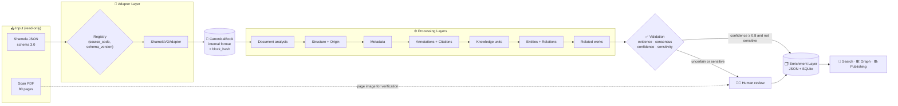
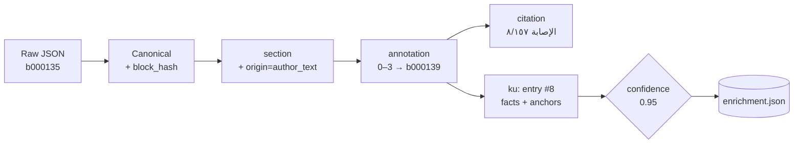
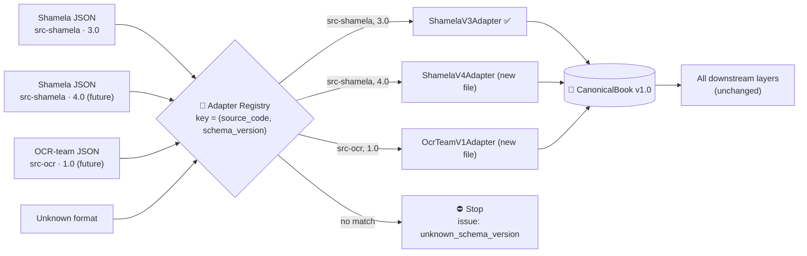
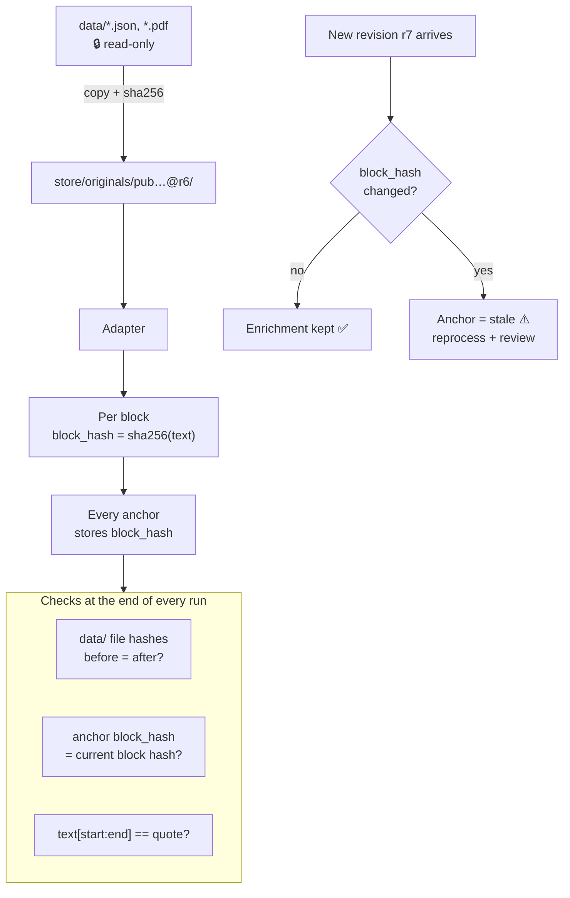
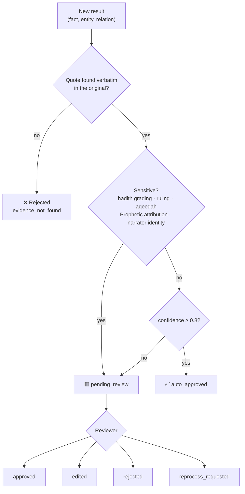
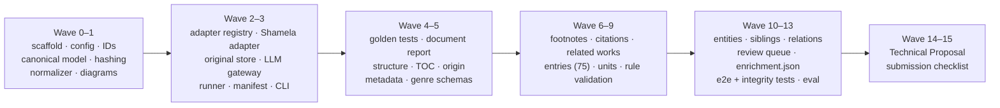

# ILM Engine — How the System Works

> **In one sentence:** the original book is never modified. Whatever JSON format arrives, a **source adapter** first converts it into one internal format (**CanonicalBook**). A sequence of **processing layers** then extracts knowledge from it, and every extracted item carries an exact pointer (**anchor**) back to the original text. All results are stored in a separate **enrichment layer**. Uncertain or high-risk results are routed to a human reviewer.

This folder contains the complete specification of the system: PRD, architecture, ADRs, data contracts, edge cases and implementation tickets. The tickets are written so that coding agents can build the system one ticket at a time. [DECISIONS.md](DECISIONS.md) is the single source of truth for names, paths, fields and numbers.

---

## 1. Big picture



**Three invariants:**
1. 🔒 **The original text is never modified.** `data/` is read-only, and every block gets a `block_hash`.
2. 📍 **Every result is traceable.** Each one carries `pub_ref + page + block_id + start/end + quote + block_hash`.
3. 🏷️ **The speaker is always recorded.** A separate `origin` distinguishes the author, the transmitters, the editor (muhaqqiq) and the AI.

---

## 2. The journey of one block: `b000135` (entry #8, page 25)

This section follows one real block from the sample book, from input to output.

### Step 0 — Raw Shamela JSON (as delivered, never changed)
```json
{
  "b": "b000135", "kind": "text",
  "text": "٨ - هند بنت عتيق بن عابد (١) بن عبد اللَّه بن عمر بن مخزوم؛ أسلمت (٢) وتزوجت، ولم يُروَ عنها شيءٌ (٣).",
  "refs": [{"start": 0, "end": 3, "to": "b000139"},
           {"start": 25, "end": 28, "to": "b000140"},
           {"start": 66, "end": 69, "to": "b000141"},
           {"start": 98, "end": 101, "to": "b000142"}]
}
```
The block sits on the `content.pages[]` entry with `n: 25`, `scan_page: 25` and `source_ref.key: "21"`.

### Step 1 — Adapter → CanonicalBook
`ShamelaV3Adapter` maps Shamela field names (`b`, `n`, `source_ref.key`) to canonical names and computes the block hash.
```json
{
  "id": "b000135", "kind": "text", "page": 25, "scan_page": 25, "order": 134,
  "text": "٨ - هند بنت عتيق … (٣).",
  "refs": [{"start": 0, "end": 3, "to": "b000139"}, "…"],
  "block_hash": "sha256:56770406fa03b53a…"
}
```

### Step 2 — Structure + Origin
The block is assigned to its section and its author layer.
```json
{"block_id": "b000135", "section_id": "sec_…", "section_title": "* وأخوة أولاد رسول اللَّه … من أُمهم خديجة:", "origin": "author_text"}
```

### Step 3 — Annotation
The entry number `٨ -` (characters 0–3) links to the editor's biographical footnote `b000139`. The marker `(١)` (characters 25–28) links to `b000140`.
```json
{"id": "ann_…", "type": "footnote", "source": {"block_id": "b000135", "start": 0, "end": 3, "quote": "٨ -"},
 "target_block": "b000139", "origin": "editor_footnote", "status": "verified"}
```

### Step 4 — Citation
Footnote `b000139` cites "الإصابة" (٨/ ١٥٧), another book, so it is recorded as a citation with its volume and page.
```json
{"id": "cit_…", "work": "wrk_…الإصابة", "volume": 8, "page": 157, "anchor": {"block_id": "b000139", "quote": "\"الإصابة\" (٨/ ١٥٧)"}}
```

### Step 5 — Knowledge unit, entity and facts
Every fact carries a verbatim quote from the original text, with offsets.
```json
{
  "id": "ku_…", "type": "biographical_entry", "entry_no": 8, "origin": "author_text",
  "subject": "ent_…هند بنت عتيق",
  "facts": [
    {"predicate": "converted_to_islam", "value": true, "assertion": "stated",
     "anchor": {"block_id": "b000135", "start": 60, "end": 65, "quote": "أسلمت"}},
    {"predicate": "has_narration", "value": false, "assertion": "stated",
     "anchor": {"block_id": "b000135", "start": 78, "end": 97, "quote": "ولم يُروَ عنها شيءٌ"}}
  ],
  "annotations": ["ann_…b000139", "ann_…b000140"]
}
```

### Step 6 — Validation → Enrichment
Confidence = base 0.95 (rule-based) × evidence 1.0 (exact quote match) × schema 1.0 = **0.95**. This is above the 0.8 threshold and not a sensitive category, so the result is `auto_approved`.
```json
{"confidence": 0.95, "review_status": "auto_approved", "issues": []}
```



---

## 3. Adapters: a new JSON format means a new adapter, nothing else



| Rule | Meaning |
|---|---|
| **Fail-closed** | An unknown `schema_version` is never guessed. The run stops and raises an issue. |
| **`raw_extras`** | Fields the adapter does not recognise are preserved in `raw_extras`, never dropped. |
| **Golden tests** | Each adapter ships a sample input and its expected canonical output. A new adapter must pass them. |
| **Versioned canonical schema** | `CanonicalBook` has its own version (`1.0`). Changing it requires an ADR. |

Adding a new format: one new file in `src/ilm_engine/adapters/` → one registry line → golden tests. **No other layer changes.**

---

## 4. Layer cards

Legend: 🟦 deterministic code · 🟩 Arabic NLP · 🟧 LLM / agent · 🟥 human

| # | Layer | Input → work → output | Method |
|---|---|---|---|
| 1 | **Adapter** | Raw JSON → canonical mapping and hashing → `CanonicalBook` | 🟦 |
| 2 | **Integrity** | Original files → read-only copy and hash verification → `run_manifest.json` | 🟦 |
| 3 | **Document analysis** | Canonical book → missing-page check (1, 2, 4, 18), statistics, quality → `document_report.json` | 🟦 |
| 4 | **Structure** | Headings + TOC → section tree (TOC `source_page` aligned via the Shamela key) → `structure.json` | 🟦 |
| 5 | **Origin** | Sections → author, transmitter, editor or footnote → `origin_map.json` | 🟦 |
| 6 | **Metadata** | Card + introduction → title, author, death year 385 AH (`b000049`), editor, conflicts → `metadata.json` | 🟦 + 🟧 |
| 7 | **Genre** | Category الأنساب + content → `biography/ansab`, secondary `hadith` → `metadata.json` | 🟦 + 🟧 (Genre Router) |
| 8 | **Annotations** | 300 `refs`, 16 `continues`, nested footnote `b000215` → `annotations.json` | 🟦 |
| 9 | **Citations** | Footnotes → cited works (الإصابة 145 times, …) and internal cross-references → `citations.json` | 🟦 + 🟩 |
| 10 | **Knowledge units** | `author_text` → 75 biographical entries → `knowledge_units.json` | 🟦 + 🟧 (Genre Extractor) |
| 11 | **Entities + Relations** | Nasab parsing + sibling groups ("ابنا أبي هالة") → `entities.json`, `relationships.json` | 🟩 + 🟧 |
| 12 | **Related works** | Citations + introduction → book family (`cites`, `same_topic_as`, …) → `related_works.json` | 🟦 + 🟧 (Citation Resolver) |
| 13 | **Search index** | Normalized text (+ optional embeddings) → `search_index.json` | 🟩 |
| 14 | **Validation** | All results → evidence match, consensus, confidence, sensitivity → `validation_report.json` | 🟦 + 🟧 (Discrepancy Resolver) |
| 15 | **Review** | Uncertain or sensitive results → approve, edit or reject → `review_queue.json` | 🟥 |
| 16 | **Store + Publish** | Approved results → `enrichment.json` + `enrichment.db` → search, graph, API | 🟦 |

---

## 5. Proving the original is untouched



- The source's declared `content_sha256` could not be reproduced, because the hashing method is not documented. It is therefore stored as `source_declared_hash` with `verified: false` and raises the issue `source_hash_unverified`. Integrity is proven with our own `canonical_content_hash` and per-block `block_hash`.

---

## 6. Review flow



Example from the sample book: footnote `b000228` contains "وإسناده ضعيف", a hadith grading. It is therefore **always sent to review, regardless of confidence.**

---

## 7. Output files (`output/pub_01M0CJECV4ZHFTP02BJQ6D3STJ@r6/`)

| File | Contents |
|---|---|
| `run_manifest.json` | Run identity: code, config, adapter, model and prompt versions, input and output hashes |
| `document_report.json` | Page accounting, missing pages, block statistics, quality |
| `metadata.json` | Title, author, editor, publisher, edition, genre, conflicts |
| `structure.json` | Section tree and the block range of each section |
| `origin_map.json` | The `origin` of every block |
| `annotations.json` | Footnote links, joined cross-page footnotes, nested footnotes |
| `citations.json` | Cited works and internal cross-references |
| `related_works.json` | Book family and related works |
| `knowledge_units.json` | 75 biographical entries with facts and anchors |
| `entities.json` / `relationships.json` | Persons, nasab, sibling and parent relations |
| `search_index.json` | Lexical index over normalized text |
| `validation_report.json` | All issues and the confidence distribution |
| `review_queue.json` | Items awaiting human review |
| `enrichment.json` | Everything in one consolidated file |
| `enrichment.db` | The same data in SQLite |
| `graph.html` | (Optional) entity graph visualisation |

---

## 8. Map of this folder

| File | Purpose |
|---|---|
| [DECISIONS.md](DECISIONS.md) | **Single source of truth** for names, paths, fields and numbers |
| [01-PRD.md](01-PRD.md) | What to build and why: goals, functional requirements, NFRs, scope |
| [02-architecture.md](02-architecture.md) | Components, layers, interfaces, storage and deployment |
| [03-data-contracts.md](03-data-contracts.md) | Schemas for CanonicalBook, anchors, enrichment records and review items |
| [04-edge-cases.md](04-edge-cases.md) | Every edge case: detection, handling and test |
| [06-ai-strategy.md](06-ai-strategy.md) | Models, prompts, consensus, confidence, genre schemas, fine-tuning |
| [07-test-plan.md](07-test-plan.md) | Acceptance tests, golden files, invariants |
| [08-roadmap.md](08-roadmap.md) | Phases, challenges, infrastructure, resources |
| [09-coverage-matrix.md](09-coverage-matrix.md) | Where each line of the assignment brief is covered |
| [adr/](adr/README.md) | Architecture Decision Records: each major decision, its alternatives and rationale |
| [tickets/](tickets/BOARD.md) | Implementation tickets, with execution order in `BOARD.md` |

Code lives at the repository root (`src/ilm_engine/`, `tests/`, `config/`). Sample input goes in `data/`, which is git-ignored (see [data/README.md](../data/README.md)).

---

## 9. Building the system with agents



> 16 waves in total (Wave 0–15): 72 MVP tickets plus 10 production backlog tickets (E16). The full ticket list per wave is in [tickets/BOARD.md](tickets/BOARD.md). Critical path: T-001 → T-010 → T-011 → T-012 → T-032 → T-034 → T-050 → T-051 → T-071 → T-072 → T-080 → T-081 → T-131 → T-132 → T-153 → T-154.

1. Open [tickets/BOARD.md](tickets/BOARD.md). It lists the tickets per wave and the dependency graph.
2. **Tickets within one wave can run in parallel.** A wave starts only after the previous wave is complete.
3. Give each agent one ticket file and instruct it to follow [DECISIONS.md](DECISIONS.md).
4. A ticket is done only when the Definition of Done holds:
   - `uv run pytest` passes
   - `uv run ruff check .` is clean
   - nothing under `data/` was modified
   - two consecutive runs produce identical output hashes
5. Finally, run `ilm-engine run --input data/demo_book_daraqutni.json --out output/` to execute the full pipeline.
