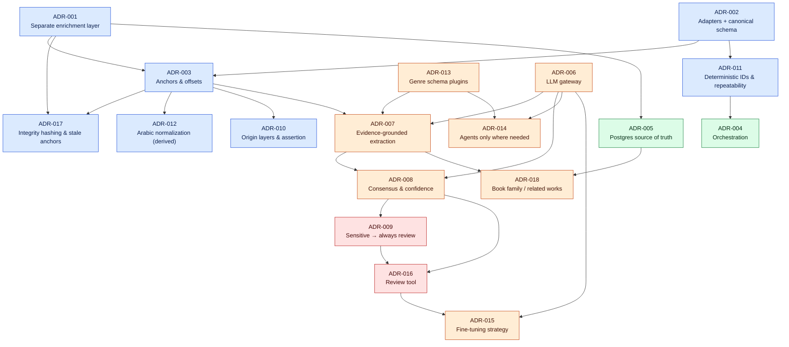

# Architecture Decision Records

All ADRs follow a MADR-style template: Status · Date · Context · Decision · Options considered · Consequences · Compliance · Related.
Names, paths and values used here are defined in [../DECISIONS.md](../DECISIONS.md). If an ADR and DECISIONS.md disagree, DECISIONS.md wins and the ADR must be fixed.

## Index

| ADR | Title | Status | Verified by |
|---|---|---|---|
| [ADR-001](ADR-001-enrichment-layer-separate.md) | Enrichment layer is stored separately from the original book | Accepted | integrity invariant tests (E02) |
| [ADR-002](ADR-002-source-adapters-canonical-schema.md) | Source adapters + versioned canonical schema | Accepted | adapter golden tests (E01) |
| [ADR-003](ADR-003-anchors-and-offsets.md) | Anchors: block ID + code-point offsets on original text | Accepted | anchor round-trip tests |
| [ADR-004](ADR-004-orchestration.md) | In-process DAG runner for MVP, Prefect for production, no Celery | Accepted | runner idempotency test |
| [ADR-005](ADR-005-postgres-source-of-truth.md) | PostgreSQL is the source of truth; vector/graph/search stores are derived | Accepted | rebuild-derived test (MVP: SQLite) |
| [ADR-006](ADR-006-llm-gateway-model-strategy.md) | LLM gateway, provider-agnostic, routed by task difficulty | Accepted | gateway tests with `null` provider |
| [ADR-007](ADR-007-evidence-grounded-extraction.md) | Evidence-grounded extraction (hallucination guard) | Accepted | evidence validator tests |
| [ADR-008](ADR-008-consensus-and-confidence.md) | Multi-model consensus and computed confidence | Accepted | confidence unit tests |
| [ADR-009](ADR-009-sensitive-content-review.md) | Sensitive content is always human-reviewed | Accepted | sensitivity routing tests |
| [ADR-010](ADR-010-origin-layers-assertion.md) | Origin layers and stated/inferred assertion | Accepted | origin map tests |
| [ADR-011](ADR-011-deterministic-ids-repeatability.md) | Deterministic IDs and repeatable runs | Accepted | run-twice hash equality test |
| [ADR-012](ADR-012-arabic-normalization.md) | Arabic normalization is derived, never overwrites | Accepted | normalizer tests |
| [ADR-013](ADR-013-genre-schemas-plugins.md) | Genre schemas as plugins | Accepted | plugin registry tests |
| [ADR-014](ADR-014-agents-only-where-needed.md) | Agents only where needed (four agents) | Accepted | architecture review |
| [ADR-015](ADR-015-fine-tuning-strategy.md) | Prompting → data → QLoRA, multi-LoRA serving | Accepted | roadmap phase gates |
| [ADR-016](ADR-016-human-review-tool.md) | Review: JSON + HTML for MVP, Argilla for production | Accepted | review queue tests |
| [ADR-017](ADR-017-integrity-hashing-stale-anchors.md) | Integrity hashing and stale anchors | Accepted | hash/stale tests |
| [ADR-018](ADR-018-book-family-related-works.md) | Book family / related-works model | Accepted | citation + related works tests |

## Decision map

How the decisions depend on each other (arrow = "builds on").

Legend: blue = data & integrity, orange = AI, red = human-in-the-loop, green = infrastructure.

## How to add an ADR

1. Copy the section layout of any ADR, number it `ADR-0NN-<slug>.md`.
2. Add any new names or values to [../DECISIONS.md](../DECISIONS.md) first.
3. Add a row to the index and an edge to the decision map.
4. A superseded ADR keeps its file; set `Status: Superseded by ADR-0NN`.
