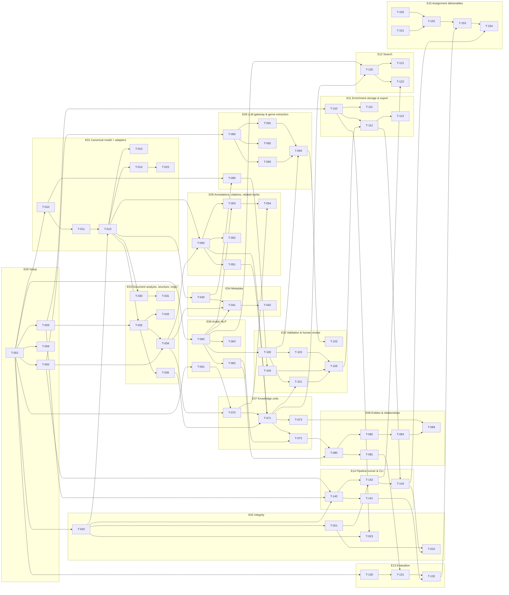

# Ticket Board — ilm-engine MVP

This board is the execution plan for coding agents. Each ticket is self-contained; `docs/DECISIONS.md` is binding for every name, path, ID format, anchor rule, issue code and threshold.

## How agents execute tickets

1. **One ticket per agent.** Pick a ticket whose `depends_on` are all `done` and that belongs to the current wave.
2. **Read first:** `docs/DECISIONS.md`, the ticket, its dependency tickets, and the docs referenced in its Context (`docs/01-PRD.md`, `02-architecture.md`, `03-data-contracts.md`, `04-edge-cases.md` when present). **Precedence:** DECISIONS.md > 03-data-contracts.md (all model/field names) > ADRs > ticket text.
3. **Branch:** `feature/<id>-<slug>` (e.g. `feature/T-070-entry-detection`), created from the branch of the ticket it depends on. Small commits; message `T-070: <imperative summary>`. Commits use the repository owner's git identity, with no tool attribution trailers.
4. **Stay in scope:** only the files listed (plus tests). If something outside scope is needed, add a note to the ticket under `## Follow-ups` instead of doing it.
5. **Never write to `data/`** or `store/originals/`. Read the sample from `data/demo_book_daraqutni.json`.
6. **Use exact sample numbers** in tests (594 blocks, 300 refs, 16 continuations, 75 entries, b000135 offsets 60–65 / 78–97, …). If the data disagrees with a ticket, stop and report — do not change the expectation silently.
7. **Finish:** run the ticket's test commands + full suite, set `status: done` in the front matter, and leave the feature branch for review. Only the repository owner merges into `main` and pushes.

### Definition of Done (every ticket)

- [ ] `uv run pytest -q` passes (whole suite, not only new tests)
- [ ] `uv run ruff check .` clean
- [ ] No file under `data/` or `store/originals/` modified (hash check)
- [ ] Outputs deterministic: running the pipeline twice gives identical output hashes (except `run_manifest.json` run_id/timestamps)
- [ ] New config keys documented in `config/default.yaml` comments; new issue codes added to DECISIONS §9 first
- [ ] Ticket acceptance criteria all checked

## Epics

| Epic | Name | Tickets |
|---|---|---|
| E00 | Setup | T-001–T-004 (4) |
| E01 | Canonical model + adapters | T-010–T-015 (6) |
| E02 | Integrity | T-020–T-023 (4) |
| E03 | Document analysis, structure, origin | T-030–T-035 (6) |
| E04 | Metadata | T-040–T-042 (3) |
| E05 | Annotations, citations, related works | T-050–T-054 (5) |
| E06 | Arabic NLP | T-060–T-063 (4) |
| E07 | Knowledge units | T-070–T-073 (4) |
| E08 | Entities & relationships | T-080–T-084 (5) |
| E09 | LLM gateway & genre extraction | T-090–T-095 (6) |
| E10 | Validation & human review | T-100–T-105 (6) |
| E11 | Enrichment storage & export | T-110–T-113 (4) |
| E12 | Search | T-120–T-122 (3) |
| E13 | Evaluation | T-130–T-132 (3) |
| E14 | Pipeline runner & CLI | T-140–T-143 (4) |
| E15 | Assignment deliverables | T-150–T-154 (5) |
| E16 | Production backlog | T-160–T-169 (10) |

## All tickets

| ID | Title | Epic | Priority | Depends on | Est. | Wave | Status |
|---|---|---|---|---|---|---|---|
| [T-001](T-001-repo-scaffold.md) | Repository scaffold (uv, pyproject, ruff, pytest) | E00 | P0 | — | S | 0 | done |
| [T-002](T-002-config-loader.md) | Config loader (default.yaml + per-book overrides) | E00 | P0 | T-001 | S | 1 | done |
| [T-003](T-003-deterministic-ids.md) | Deterministic ID generation (ids.py) | E00 | P0 | T-001 | S | 1 | done |
| [T-004](T-004-logging.md) | Structured logging | E00 | P1 | T-001 | S | 1 | done |
| [T-010](T-010-canonical-models.md) | Canonical book models (canonical/models.py) | E01 | P0 | T-001 | M | 1 | done |
| [T-011](T-011-adapter-protocol-registry.md) | Adapter protocol + registry (fail-closed) | E01 | P0 | T-010 | S | 2 | done |
| [T-012](T-012-shamela-v3-adapter.md) | ShamelaV3Adapter (src-shamela, af_schema 3.0) | E01 | P0 | T-011, T-020 | M | 3 | done |
| [T-013](T-013-raw-extras.md) | Preserve unknown fields (raw_extras) | E01 | P1 | T-012 | S | 4 | todo |
| [T-014](T-014-adapter-golden-tests.md) | Adapter golden-file contract tests | E01 | P0 | T-012 | S | 4 | todo |
| [T-015](T-015-adapter-authoring-guide.md) | Adapter authoring guide + example OCR-team v1 adapter | E01 | P1 | T-014 | M | 5 | todo |
| [T-020](T-020-hashing.md) | Hashing utilities (block hash, canonical content hash) | E02 | P0 | T-001 | S | 1 | done |
| [T-021](T-021-original-store.md) | Read-only original store | E02 | P0 | T-020 | S | 2 | done |
| [T-022](T-022-integrity-invariant-tests.md) | Integrity invariant tests | E02 | P0 | T-021, T-143 | S | 13 | todo |
| [T-023](T-023-revision-diff-stale-anchors.md) | Revision diff + stale anchor detection | E02 | P1 | T-020, T-110 | M | 3 | done |
| [T-030](T-030-document-analysis-report.md) | Document analysis report (quality & stats) | E03 | P0 | T-012 | S | 4 | todo |
| [T-031](T-031-page-gap-classification.md) | Missing-page detection and classification | E03 | P1 | T-030 | S | 5 | todo |
| [T-032](T-032-structure-tree.md) | Structure tree from headings | E03 | P0 | T-012, T-003 | M | 4 | todo |
| [T-033](T-033-toc-alignment.md) | TOC alignment via source_ref.key | E03 | P0 | T-032 | S | 5 | todo |
| [T-034](T-034-origin-assignment.md) | Origin layer assignment (+ per-book override) | E03 | P0 | T-032, T-002 | M | 5 | todo |
| [T-035](T-035-section-block-ranges.md) | Section → block ranges and page index | E03 | P1 | T-032 | S | 5 | todo |
| [T-040](T-040-metadata-card.md) | Bibliographic metadata from source card | E04 | P0 | T-012 | S | 4 | todo |
| [T-041](T-041-metadata-from-content.md) | Metadata derived from book content | E04 | P1 | T-040, T-034, T-060 | M | 6 | todo |
| [T-042](T-042-metadata-conflicts.md) | Metadata conflict & variant detection | E04 | P1 | T-041 | S | 7 | todo |
| [T-050](T-050-refs-resolution.md) | Footnote reference resolution | E05 | P0 | T-012, T-034 | S | 6 | todo |
| [T-051](T-051-continued-footnotes.md) | Join footnotes continued across pages | E05 | P0 | T-050 | S | 7 | todo |
| [T-052](T-052-nested-footnotes.md) | Nested footnotes and unlinked footnotes | E05 | P1 | T-050 | S | 7 | todo |
| [T-053](T-053-citations.md) | Citations + related works (book family) extraction | E05 | P0 | T-050, T-060 | M | 7 | todo |
| [T-054](T-054-internal-references.md) | Internal cross-references | E05 | P1 | T-070, T-053 | S | 8 | todo |
| [T-060](T-060-arabic-normalizer.md) | Arabic search normalizer | E06 | P0 | T-001 | S | 1 | done |
| [T-061](T-061-arabic-digits.md) | Arabic-Indic digits and number words | E06 | P0 | T-001 | S | 1 | done |
| [T-062](T-062-nasab-parser.md) | Nasab (lineage chain) parser | E06 | P0 | T-060 | M | 2 | done |
| [T-063](T-063-camel-tools-adapter.md) | Optional CAMeL Tools morphology adapter | E06 | P2 | T-060 | M | 2 | done |
| [T-070](T-070-entry-detection.md) | Biographical entry detection (75 entries) | E07 | P0 | T-034, T-061 | M | 6 | todo |
| [T-071](T-071-unit-assembly.md) | Knowledge unit assembly (entry + footnotes + section) | E07 | P0 | T-070, T-050, T-051, T-035 | M | 8 | todo |
| [T-072](T-072-unit-facts-rules.md) | Rule-based unit facts | E07 | P1 | T-071, T-062 | M | 9 | todo |
| [T-073](T-073-section-membership.md) | Section membership and group headings | E07 | P1 | T-071 | S | 9 | todo |
| [T-080](T-080-person-entities.md) | Person entities from units and footnotes | E08 | P0 | T-072, T-062 | M | 10 | todo |
| [T-081](T-081-alias-dedup.md) | Alias resolution and de-duplication | E08 | P1 | T-080 | M | 11 | todo |
| [T-082](T-082-sibling-groups.md) | Sibling grouping by closing phrases | E08 | P0 | T-080 | M | 11 | todo |
| [T-083](T-083-relation-kinds.md) | Relation kinds (full/paternal/maternal) incl. لأم ولد rule | E08 | P0 | T-082 | S | 12 | todo |
| [T-084](T-084-inferred-relations.md) | Inferred relations from headings (assertion=inferred) | E08 | P1 | T-073, T-083 | S | 13 | todo |
| [T-090](T-090-llm-gateway-null-cache.md) | LLM gateway, null provider, response cache | E09 | P0 | T-002 | M | 2 | done |
| [T-091](T-091-anthropic-provider.md) | Anthropic provider (primary extractor) | E09 | P1 | T-090 | S | 3 | done |
| [T-092](T-092-litellm-provider.md) | LiteLLM provider (second, independent model family) | E09 | P1 | T-090 | S | 3 | done |
| [T-093](T-093-versioned-prompts.md) | Versioned prompt files | E09 | P1 | T-090 | S | 3 | done |
| [T-094](T-094-llm-extract-with-evidence.md) | LLM extraction with mandatory evidence | E09 | P1 | T-091, T-093, T-100 | M | 4 | todo |
| [T-095](T-095-genre-schemas-router.md) | Genre plugin schemas (7) + genre router | E09 | P0 | T-040, T-010 | M | 5 | todo |
| [T-100](T-100-evidence-guard.md) | Evidence guard (hallucination guard) | E10 | P0 | T-060 | S | 2 | done |
| [T-101](T-101-rule-validation.md) | Rule-based validation | E10 | P0 | T-100, T-071 | S | 9 | todo |
| [T-102](T-102-consensus.md) | Multi-model consensus & discrepancy detection | E10 | P1 | T-094 | M | 5 | todo |
| [T-103](T-103-confidence.md) | Confidence scoring | E10 | P0 | T-100 | S | 3 | done |
| [T-104](T-104-sensitivity.md) | Sensitivity rules (always human review) | E10 | P0 | T-095 | S | 6 | todo |
| [T-105](T-105-review-queue-viewer.md) | Review queue, decisions loop + static HTML reviewer view | E10 | P0 | T-103, T-104, T-101 | M | 10 | todo |
| [T-110](T-110-json-store.md) | JSON enrichment store | E11 | P0 | T-003 | S | 2 | done |
| [T-111](T-111-sqlite-store.md) | SQLite enrichment database | E11 | P1 | T-110 | M | 3 | done |
| [T-112](T-112-consolidated-enrichment.md) | Consolidated enrichment.json | E11 | P0 | T-110, T-105 | S | 11 | todo |
| [T-113](T-113-graph-html.md) | Knowledge graph export (graph.html) | E11 | P2 | T-112 | S | 12 | todo |
| [T-120](T-120-lexical-search-index.md) | Normalized lexical search index | E12 | P1 | T-060, T-071 | S | 9 | todo |
| [T-121](T-121-semantic-search-optional.md) | Optional semantic search (BGE-M3) | E12 | P2 | T-120 | M | 10 | todo |
| [T-122](T-122-search-cli.md) | Search CLI | E12 | P1 | T-120, T-142 | S | 10 | todo |
| [T-130](T-130-gold-index-sample.md) | Gold sample from printed index (PDF pp. 76–80) | E13 | P1 | T-001 | M | 1 | done |
| [T-131](T-131-eval-precision-recall.md) | Entity evaluation (precision/recall vs gold) | E13 | P1 | T-130, T-081 | S | 12 | todo |
| [T-132](T-132-eval-report.md) | Evaluation & run summary report | E13 | P1 | T-131, T-141 | S | 13 | todo |
| [T-140](T-140-step-runner.md) | Step registry & DAG runner (cached, idempotent) | E14 | P0 | T-002, T-003, T-020 | M | 2 | done |
| [T-141](T-141-run-manifest.md) | Run manifest (provenance of a run) | E14 | P0 | T-140 | S | 3 | done |
| [T-142](T-142-cli.md) | CLI: run | verify | search | eval | review apply | E14 | P0 | T-140, T-021 | S | 3 | done |
| [T-143](T-143-e2e-determinism.md) | End-to-end integration test + determinism | E14 | P0 | T-142, T-112 | S | 12 | todo |
| [T-150](T-150-architecture-diagram.md) | Deliverable 1: System architecture diagram | E15 | P0 | — | S | 0 | done |
| [T-151](T-151-data-flow-diagram.md) | Deliverable 2: Automation & data-flow diagram | E15 | P0 | — | S | 0 | done |
| [T-152](T-152-export-diagrams.md) | Export diagrams to SVG/PNG | E15 | P1 | T-150, T-151 | S | 1 | done |
| [T-153](T-153-technical-proposal.md) | Technical_Proposal.md (all assignment deliverables) | E15 | P0 | T-152, T-132 | L | 14 | todo |
| [T-154](T-154-submission-readme.md) | Submission README & checklist | E15 | P1 | T-153, T-143 | S | 15 | todo |
| [T-160](T-160-prefect-flows.md) | Prefect flows for the book pipeline | E16 | P2 | T-143 | L | backlog | backlog |
| [T-161](T-161-postgres-schema.md) | PostgreSQL schema + migrations (source of truth) | E16 | P2 | T-143 | L | backlog | backlog |
| [T-162](T-162-qdrant-sync.md) | Qdrant vector sync | E16 | P2 | T-143 | L | backlog | backlog |
| [T-163](T-163-neo4j-sync.md) | Neo4j knowledge-graph sync | E16 | P2 | T-143 | L | backlog | backlog |
| [T-164](T-164-opensearch-arabic.md) | OpenSearch with Arabic analyzer + hybrid search | E16 | P2 | T-143 | L | backlog | backlog |
| [T-165](T-165-argilla-review.md) | Argilla human review integration | E16 | P2 | T-143 | L | backlog | backlog |
| [T-166](T-166-publishing-api.md) | FastAPI publishing & search API | E16 | P2 | T-143 | L | backlog | backlog |
| [T-167](T-167-vllm-serving.md) | vLLM serving + multi-LoRA | E16 | P2 | T-143 | L | backlog | backlog |
| [T-168](T-168-fine-tuning-pipeline.md) | Fine-tuning pipeline (QLoRA/PEFT) | E16 | P2 | T-143 | L | backlog | backlog |
| [T-169](T-169-observability.md) | Observability, cost & audit | E16 | P2 | T-143 | L | backlog | backlog |

## Execution waves

A wave can start when every ticket of all previous waves is `done`. Tickets inside one wave are independent and can run in parallel (one agent each). Wave number = longest dependency chain to the ticket.

### Wave 0 (3 tickets)

- [T-001](T-001-repo-scaffold.md) Repository scaffold (uv, pyproject, ruff, pytest) (P0)
- [T-150](T-150-architecture-diagram.md) Deliverable 1: System architecture diagram (P0)
- [T-151](T-151-data-flow-diagram.md) Deliverable 2: Automation & data-flow diagram (P0)

### Wave 1 (9 tickets)

- [T-002](T-002-config-loader.md) Config loader (default.yaml + per-book overrides) (P0)
- [T-003](T-003-deterministic-ids.md) Deterministic ID generation (ids.py) (P0)
- [T-004](T-004-logging.md) Structured logging (P1)
- [T-010](T-010-canonical-models.md) Canonical book models (canonical/models.py) (P0)
- [T-020](T-020-hashing.md) Hashing utilities (block hash, canonical content hash) (P0)
- [T-060](T-060-arabic-normalizer.md) Arabic search normalizer (P0)
- [T-061](T-061-arabic-digits.md) Arabic-Indic digits and number words (P0)
- [T-130](T-130-gold-index-sample.md) Gold sample from printed index (PDF pp. 76–80) (P1)
- [T-152](T-152-export-diagrams.md) Export diagrams to SVG/PNG (P1)

### Wave 2 (8 tickets)

- [T-011](T-011-adapter-protocol-registry.md) Adapter protocol + registry (fail-closed) (P0)
- [T-021](T-021-original-store.md) Read-only original store (P0)
- [T-062](T-062-nasab-parser.md) Nasab (lineage chain) parser (P0)
- [T-063](T-063-camel-tools-adapter.md) Optional CAMeL Tools morphology adapter (P2)
- [T-090](T-090-llm-gateway-null-cache.md) LLM gateway, null provider, response cache (P0)
- [T-100](T-100-evidence-guard.md) Evidence guard (hallucination guard) (P0)
- [T-110](T-110-json-store.md) JSON enrichment store (P0)
- [T-140](T-140-step-runner.md) Step registry & DAG runner (cached, idempotent) (P0)

### Wave 3 (9 tickets)

- [T-012](T-012-shamela-v3-adapter.md) ShamelaV3Adapter (src-shamela, af_schema 3.0) (P0)
- [T-023](T-023-revision-diff-stale-anchors.md) Revision diff + stale anchor detection (P1)
- [T-091](T-091-anthropic-provider.md) Anthropic provider (primary extractor) (P1)
- [T-092](T-092-litellm-provider.md) LiteLLM provider (second, independent model family) (P1)
- [T-093](T-093-versioned-prompts.md) Versioned prompt files (P1)
- [T-103](T-103-confidence.md) Confidence scoring (P0)
- [T-111](T-111-sqlite-store.md) SQLite enrichment database (P1)
- [T-141](T-141-run-manifest.md) Run manifest (provenance of a run) (P0)
- [T-142](T-142-cli.md) CLI: run | verify | search | eval | review apply (P0)

### Wave 4 (6 tickets)

- [T-013](T-013-raw-extras.md) Preserve unknown fields (raw_extras) (P1)
- [T-014](T-014-adapter-golden-tests.md) Adapter golden-file contract tests (P0)
- [T-030](T-030-document-analysis-report.md) Document analysis report (quality & stats) (P0)
- [T-032](T-032-structure-tree.md) Structure tree from headings (P0)
- [T-040](T-040-metadata-card.md) Bibliographic metadata from source card (P0)
- [T-094](T-094-llm-extract-with-evidence.md) LLM extraction with mandatory evidence (P1)

### Wave 5 (7 tickets)

- [T-015](T-015-adapter-authoring-guide.md) Adapter authoring guide + example OCR-team v1 adapter (P1)
- [T-031](T-031-page-gap-classification.md) Missing-page detection and classification (P1)
- [T-033](T-033-toc-alignment.md) TOC alignment via source_ref.key (P0)
- [T-034](T-034-origin-assignment.md) Origin layer assignment (+ per-book override) (P0)
- [T-035](T-035-section-block-ranges.md) Section → block ranges and page index (P1)
- [T-095](T-095-genre-schemas-router.md) Genre plugin schemas (7) + genre router (P0)
- [T-102](T-102-consensus.md) Multi-model consensus & discrepancy detection (P1)

### Wave 6 (4 tickets)

- [T-041](T-041-metadata-from-content.md) Metadata derived from book content (P1)
- [T-050](T-050-refs-resolution.md) Footnote reference resolution (P0)
- [T-070](T-070-entry-detection.md) Biographical entry detection (75 entries) (P0)
- [T-104](T-104-sensitivity.md) Sensitivity rules (always human review) (P0)

### Wave 7 (4 tickets)

- [T-042](T-042-metadata-conflicts.md) Metadata conflict & variant detection (P1)
- [T-051](T-051-continued-footnotes.md) Join footnotes continued across pages (P0)
- [T-052](T-052-nested-footnotes.md) Nested footnotes and unlinked footnotes (P1)
- [T-053](T-053-citations.md) Citations + related works (book family) extraction (P0)

### Wave 8 (2 tickets)

- [T-054](T-054-internal-references.md) Internal cross-references (P1)
- [T-071](T-071-unit-assembly.md) Knowledge unit assembly (entry + footnotes + section) (P0)

### Wave 9 (4 tickets)

- [T-072](T-072-unit-facts-rules.md) Rule-based unit facts (P1)
- [T-073](T-073-section-membership.md) Section membership and group headings (P1)
- [T-101](T-101-rule-validation.md) Rule-based validation (P0)
- [T-120](T-120-lexical-search-index.md) Normalized lexical search index (P1)

### Wave 10 (4 tickets)

- [T-080](T-080-person-entities.md) Person entities from units and footnotes (P0)
- [T-105](T-105-review-queue-viewer.md) Review queue, decisions loop + static HTML reviewer view (P0)
- [T-121](T-121-semantic-search-optional.md) Optional semantic search (BGE-M3) (P2)
- [T-122](T-122-search-cli.md) Search CLI (P1)

### Wave 11 (3 tickets)

- [T-081](T-081-alias-dedup.md) Alias resolution and de-duplication (P1)
- [T-082](T-082-sibling-groups.md) Sibling grouping by closing phrases (P0)
- [T-112](T-112-consolidated-enrichment.md) Consolidated enrichment.json (P0)

### Wave 12 (4 tickets)

- [T-083](T-083-relation-kinds.md) Relation kinds (full/paternal/maternal) incl. لأم ولد rule (P0)
- [T-113](T-113-graph-html.md) Knowledge graph export (graph.html) (P2)
- [T-131](T-131-eval-precision-recall.md) Entity evaluation (precision/recall vs gold) (P1)
- [T-143](T-143-e2e-determinism.md) End-to-end integration test + determinism (P0)

### Wave 13 (3 tickets)

- [T-022](T-022-integrity-invariant-tests.md) Integrity invariant tests (P0)
- [T-084](T-084-inferred-relations.md) Inferred relations from headings (assertion=inferred) (P1)
- [T-132](T-132-eval-report.md) Evaluation & run summary report (P1)

### Wave 14 (1 tickets)

- [T-153](T-153-technical-proposal.md) Technical_Proposal.md (all assignment deliverables) (P0)

### Wave 15 (1 tickets)

- [T-154](T-154-submission-readme.md) Submission README & checklist (P1)

Backlog (production, E16): [T-160](T-160-prefect-flows.md), [T-161](T-161-postgres-schema.md), [T-162](T-162-qdrant-sync.md), [T-163](T-163-neo4j-sync.md), [T-164](T-164-opensearch-arabic.md), [T-165](T-165-argilla-review.md), [T-166](T-166-publishing-api.md), [T-167](T-167-vllm-serving.md), [T-168](T-168-fine-tuning-pipeline.md), [T-169](T-169-observability.md) — scheduled after the MVP, not part of the waves.

### Critical path

T-001 → T-010 → T-011 → T-012 → T-032 → T-034 → T-050 → T-051 → T-071 → T-072 → T-080 → T-081 → T-131 → T-132 → T-153 → T-154

## Dependency graph



## Agent prompt template (copy, replace `<ID>`)

```text
You are implementing ticket <ID> of the ilm-engine MVP in the repository at <REPO_ROOT>.
1. Read docs/DECISIONS.md fully. Its names, paths, ID formats, anchor rules, issue codes and thresholds are binding. Model and field names come from docs/03-data-contracts.md (it wins over ticket text).
2. Read docs/tickets/<ID>-*.md and every ticket in its depends_on (they are already done; reuse their code, do not rewrite it).
3. Read the requirement docs referenced in the ticket Context (docs/01-PRD.md, 02-architecture.md, 03-data-contracts.md, 04-edge-cases.md).
4. Create branch feature/<ID>-<slug>. Implement ONLY the Scope, in the listed Files, with tests.
5. Never modify data/ or store/originals/. Use the sample book data/demo_book_daraqutni.json for tests with the exact expected numbers in the ticket.
6. Run the ticket's Test commands, then `uv run pytest -q && uv run ruff check .`.
7. If an acceptance criterion contradicts the real data, stop and report the evidence instead of changing the criterion.
8. Tick the acceptance criteria, set status: done in the ticket front matter, commit as '<ID>: <summary>'.
9. Report: files changed, test results, any follow-ups.
```

## Parallel run recipe

For wave N: start one agent per ticket listed under *Wave N* with the template above (worktree isolation recommended, one branch per ticket). When every branch of the wave passes the full test suite, the repository owner reviews and merges them into `main`; then start wave N+1.
